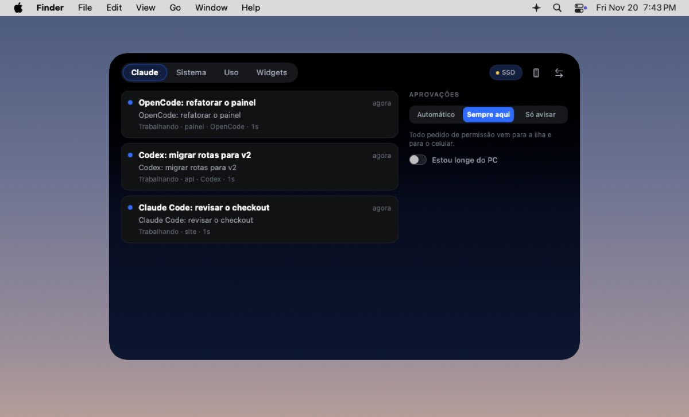
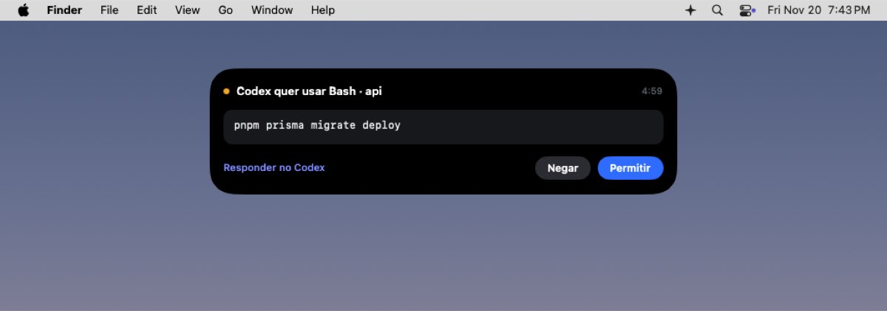
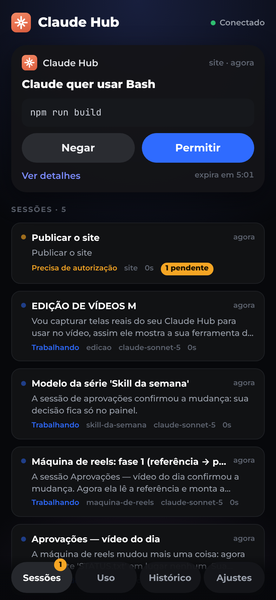
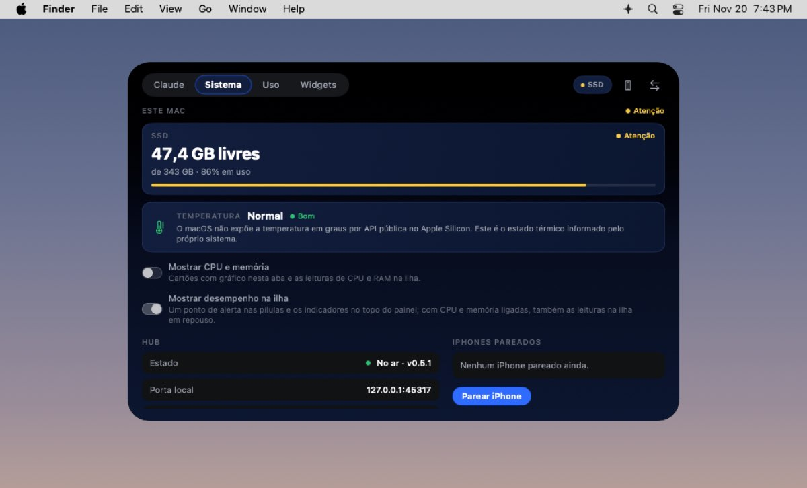
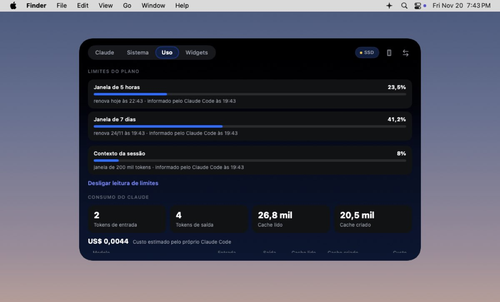
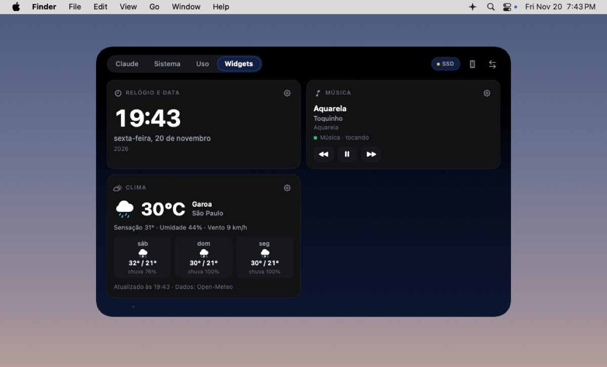

# Claude Hub by Kalox

An open-source Dynamic Island for macOS to monitor Claude Code, OpenAI Codex, OpenCode, system performance, and remotely manage AI coding agents from your iPhone.

[Português](README_PTBR.md) · [Install](docs/INSTALL_MACOS.md) · [iPhone](docs/IPHONE_SETUP.md) · [What works today](docs/FEATURE_MATRIX.md) · [Changelog](CHANGELOG.md)



| Permission request on the island | The same request on the iPhone |
|---|---|
|  |  |

| System | Usage | Widgets |
|---|---|---|
|  |  |  |

These are captures of the real app, not mock-ups. The macOS ones come from the native app running on an Apple Silicon virtual Mac in CI. Session titles and the Codex request in the first two images are test events sent through the same path the integrations use. The Mac numbers are that machine's. The usage limits are an example in Claude Code's official format, not a real account. The iPhone image is the PWA in a browser emulating an iPhone. The UI is currently in Portuguese.

## What it does

- **A Dynamic Island at the top of your Mac.** It shows each agent session: working, waiting for you, needs permission, finished, error, idle. Each session has its project, title, last event and elapsed time.
- **Remote approvals.** Allow or deny a command from the island or from your iPhone, with the full command in view. There is no auto-approve mode.
- **Three agents, each through its official extension point:**
  - Claude Code via hooks;
  - OpenAI Codex CLI via command hooks;
  - OpenCode (1.x and 2.x) via a plugin.
- **Mac monitoring.** CPU, memory, SSD, battery and thermal state, with charts and green/yellow/red levels. CPU and memory are hidden by default.
- **Claude Code usage and plan limits.** Shown only with data Claude Code itself reports (OpenTelemetry and the status line). With no data, it says so. Nothing is estimated.
- **Widgets.** Clock, now playing, weather.
- **Local-first.** Everything runs on your Mac. The iPhone connects through your own Tailscale network. There is no cloud server and no account.

## Integration status

Each line was checked against the **real agent** in CI (macOS and Linux) unless marked otherwise. The model in those tests is a local fake server, so no API key is involved. The agent, its hooks or plugin, the hub and the decisions are real. Full detail and evidence: [`docs/FEATURE_MATRIX.md`](docs/FEATURE_MATRIX.md).

| | Claude Code | OpenAI Codex CLI | OpenCode |
|---|---|---|---|
| Tested versions | 2.1.329 | 0.171.0 | 1.19.6 and 2.3.2 |
| Integration point | hooks in `~/.claude/settings.json` | hooks in `~/.codex/hooks.json` | plugin in `~/.config/opencode/plugins/` |
| Sessions, project and title | ✅ real agent | ✅ real agent | ✅ real agent |
| Several sessions at once | ✅ | ✅ real agent (2 at once) | ✅ real agent (2 at once) |
| Tool calls and last event | ✅ | ✅ real agent | ✅ real agent |
| Task finished | ✅ | ✅ real agent | ✅ real agent |
| Task error | ✅ tests | ❌ Codex has no error hook | ⚠️ tests only |
| To-do progress | ✅ | ❌ not exposed by hooks | ⚠️ 1.x tests only; ❌ 2.x |
| Permission requests on island and iPhone | ✅ real agent | ✅ real agent | ✅ real agent |
| Remote allow / deny, agent obeys | ✅ real agent | ✅ real agent | ✅ real agent |
| Token usage and cost | ✅ real agent (opt-in) | ❌ not implemented | ❌ not implemented |
| Plan limits (5 h / 7 days) | ⚠️ only checked with the official docs example | ❌ not implemented | ❌ not implemented |
| One-time step for you | none | trust the new hooks once in Codex ("Review hooks") | none |

None of the three has been exercised on a physical MacBook by this project's CI. The only real-device report so far is the author's own Mac, which ran Claude Code with version 0.4.0.

## Installing

Nothing is compiled on your Mac. No Xcode, Homebrew or Node is needed: the installer contains everything.

1. Download `ClaudeHub-0.5.1-arm64.dmg` from the [latest release](https://github.com/LabsKalox/Claude-Hub/releases/latest). It is for Apple Silicon (M1, M2, M3 and later) on macOS 14 or newer. Compare its SHA-256 with the one on the release page.
2. Open the `.dmg` and drag **ClaudeHub** to **Applications**.
3. Open the app. The **setup assistant** installs the background service and the Claude Code hooks, checks health, and turns on Codex and OpenCode if you want them.

> **The app is not signed with an Apple Developer ID and not notarized.** macOS will block it the first time you open it. The [install guide](docs/INSTALL_MACOS.md) explains the official way to allow it in *System Settings → Privacy & Security*. This project never disables or bypasses Gatekeeper.

Then connect your iPhone: [`docs/IPHONE_SETUP.md`](docs/IPHONE_SETUP.md). You'll need Tailscale on both devices. You pair by scanning a QR code and add the web app to your home screen.

## How it works

```
Claude Code ── hooks ──┐
Codex CLI  ── hooks ───┼──► local hub (127.0.0.1:4317) ──► island (native SwiftUI app)
OpenCode   ── plugin ──┘          │
                                  └── 127.0.0.1:4318 ── tailscale serve ──► iPhone (PWA + Web Push)
```

- When an agent asks for permission, its hook or plugin holds the request. The hub then shows the request on the island and the iPhone, and returns your decision in the agent's own format.
- If the hub is down or you don't answer in time, the agent falls back to its normal terminal prompt.
- Pairing uses a one-time code. Every device gets its own revocable token. Every decision is recorded in an audit log.
- Details: [`docs/ARCHITECTURE.md`](docs/ARCHITECTURE.md) and [`docs/SECURITY.md`](docs/SECURITY.md).

## Known limitations

- **No Apple notarization.** The project has no paid Apple Developer account. You must allow the app manually once (see above).
- **Not yet validated on real devices by CI.** The installer, island and approvals are tested on an Apple Silicon virtual Mac. The iPhone PWA is tested in an emulated browser. Push notifications haven't been confirmed working on a real iPhone.
- **Not tested at all:**
  - real clicks on the native island;
  - animations;
  - the notch;
  - multiple monitors;
  - the battery card;
  - music controls.
- **Codex and OpenCode:** there is no token usage and no limits. Codex reports no errors or progress through hooks.
- **No temperature in degrees.** macOS exposes only the thermal state on Apple Silicon.
- **Portuguese UI.** The interface is in Portuguese for now.

## Development

The hub, the integrations and the PWA are TypeScript (Node ≥ 22.13, pnpm). The island is Swift/SwiftUI. All building, testing and packaging happens on GitHub Actions:

- `CI (Linux)`;
- `CI macOS` on Apple Silicon runners;
- `Agentes reais`, with the real Codex and OpenCode.

See [`CONTRIBUTING.md`](CONTRIBUTING.md) and [`docs/DEVELOPMENT.md`](docs/DEVELOPMENT.md).

```
apps/macos              native island (Swift/SwiftUI) and installer scripts
apps/web                iPhone PWA and web replica of the island (Next.js)
services/api            local hub (Node, Fastify, SQLite, WebSocket, Web Push)
packages/claude-bridge  integrations (Claude Code, Codex, OpenCode), CLI, setup
packages/shared         shared contracts
tests/e2e               Playwright tests
tests/real              real Claude Code / Codex / OpenCode; macOS smoke and install tests
```

## Trademarks

Claude Hub by Kalox is an independent open-source project. It is not affiliated with, endorsed by or sponsored by Anthropic, OpenAI or the OpenCode project:

- "Claude" and "Claude Code" are trademarks of Anthropic (the app uses its own star icon, not the Claude logo);
- "OpenAI" and "Codex" are trademarks of OpenAI;
- "OpenCode" belongs to its owners.

These names are used only to say which tools the app works with.

## License

[MIT](LICENSE). Bundled third-party components keep their own licenses, listed in `THIRD_PARTY_NOTICES.txt` inside the app.
