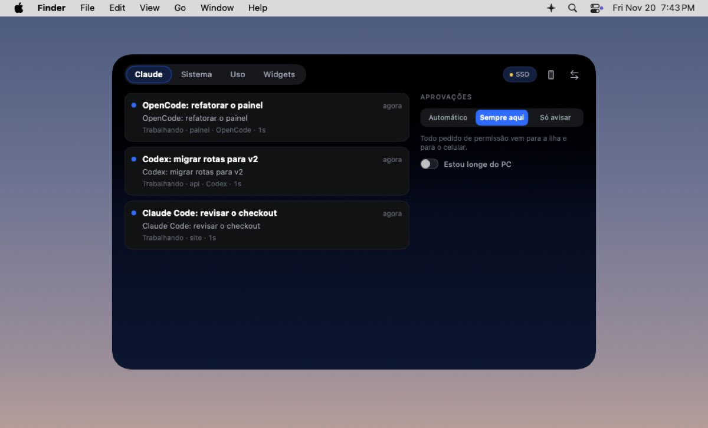
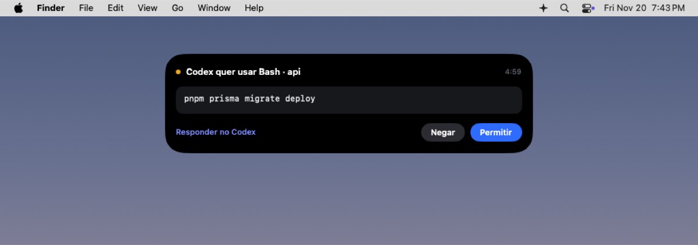
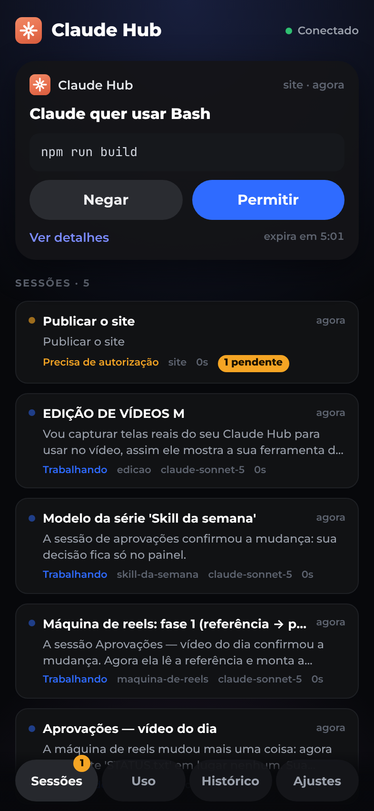
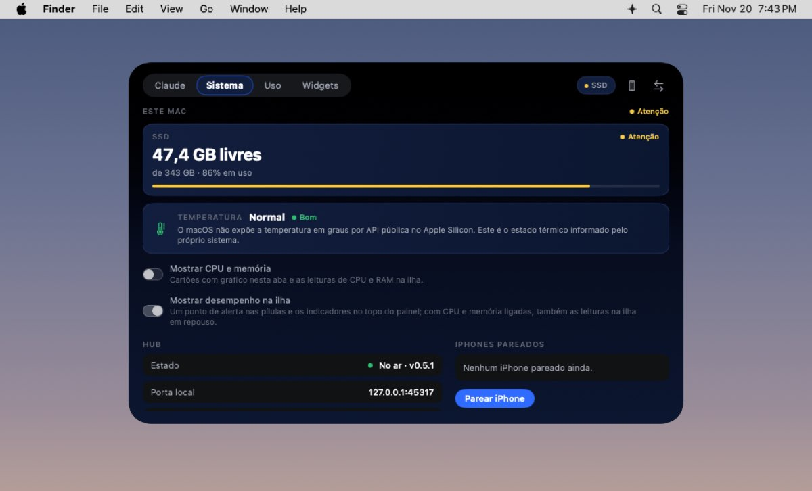
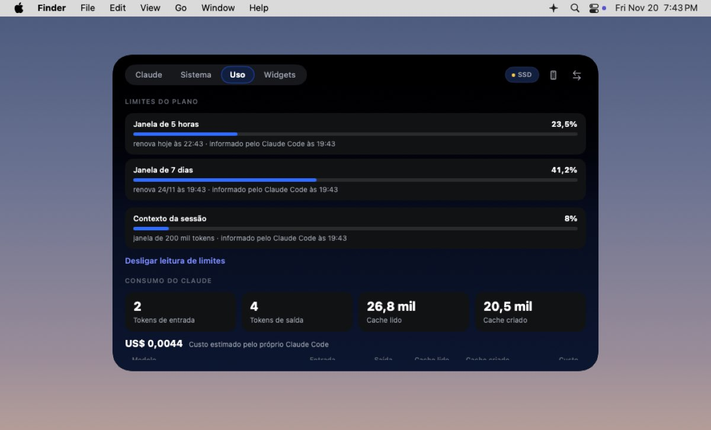
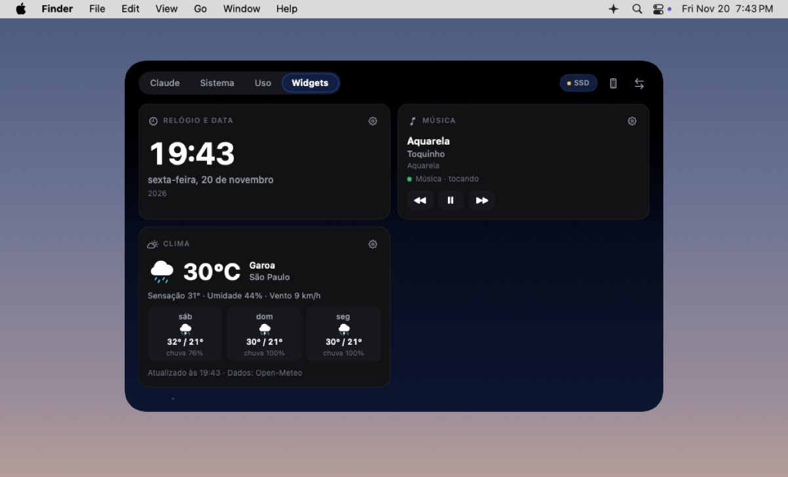

# Claude Hub by Kalox

Uma Dynamic Island open-source para macOS que acompanha o Claude Code, o OpenAI Codex, o OpenCode e o desempenho do Mac — e deixa você gerenciar agentes de programação com IA pelo iPhone.

[English](README.md) · [Instalar](docs/INSTALL_MACOS.md) · [iPhone](docs/IPHONE_SETUP.md) · [O que funciona hoje](docs/FEATURE_MATRIX.md) · [Changelog](CHANGELOG.md)



| Pedido de permissão na ilha | O mesmo pedido no iPhone |
|---|---|
|  |  |

| Sistema | Uso | Widgets |
|---|---|---|
|  |  |  |

São capturas do app real, não montagens. As do macOS vêm do app nativo rodando num Mac Apple Silicon virtual do CI. Os títulos das sessões e o pedido do Codex nas duas primeiras imagens são eventos de teste, enviados pelo mesmo caminho que as integrações usam. Os números do Mac são daquela máquina. Os limites são um exemplo no formato oficial do Claude Code, não uma conta real. A imagem do iPhone é o app web num navegador simulando um iPhone.

## O que faz

- **Uma Dynamic Island no topo do Mac.** Mostra cada sessão de agente: trabalhando, esperando você, precisa de autorização, terminou, erro, inativa. Cada sessão aparece com projeto, título, último evento e tempo.
- **Aprovação remota.** Você permite ou nega um comando pela ilha ou pelo iPhone, com o comando completo à vista. Não existe modo de aprovar automaticamente.
- **Três agentes, cada um pelo seu ponto de extensão oficial:**
  - Claude Code, por hooks;
  - Codex CLI, por command hooks;
  - OpenCode (1.x e 2.x), por plugin.
- **Monitor do Mac.** CPU, memória, SSD, bateria e estado térmico, com gráficos e níveis verde/amarelo/vermelho. CPU e memória ficam ocultos por padrão.
- **Consumo e limites do Claude Code.** Aparecem só com dados que o próprio Claude Code informa. Sem dado, a tela diz isso; nada é estimado.
- **Widgets.** Relógio, música tocando e clima.
- **Tudo local.** Roda no seu Mac. O iPhone conecta pela sua própria rede Tailscale. Não há servidor na nuvem nem conta.

## Situação das integrações

Cada linha foi verificada com o **agente real** no CI (macOS e Linux), salvo indicação. Nesses testes o modelo é um servidor falso local, sem chave de API, que responde nos formatos oficiais, inclusive os cabeçalhos de limite que o Codex lê. ➖ = o próprio agente não tem esse recurso. O agente, seus hooks ou plugin, o hub e as decisões são reais. Detalhes e evidências estão em [`docs/FEATURE_MATRIX.md`](docs/FEATURE_MATRIX.md).

| | Claude Code | OpenAI Codex CLI | OpenCode |
|---|---|---|---|
| Versões testadas | 2.1.329 | 0.171.0 | 1.19.6 e 2.3.2 |
| Ponto de integração | hooks em `~/.claude/settings.json` | hooks em `~/.codex/hooks.json` | plugin em `~/.config/opencode/plugins/` |
| Sessões, projeto e título | ✅ agente real | ✅ agente real | ✅ agente real |
| Várias sessões ao mesmo tempo | ✅ | ✅ agente real (3 ao mesmo tempo) | ✅ agente real (3 ao mesmo tempo) |
| Ferramentas e último evento | ✅ | ✅ agente real | ✅ agente real |
| Fim da tarefa | ✅ | ✅ agente real | ✅ agente real |
| Erro da tarefa | ✅ testes | ✅ agente real (lido do arquivo de sessão do Codex) | ✅ agente real (1.x e 2.x) |
| Progresso por lista de tarefas | ✅ | ➖ o Codex 0.171 não tem ferramenta de checklist (usa "metas") | ✅ agente real (1.x) · ➖ a 2.x não tem lista de tarefas |
| Pedido de autorização na ilha e no iPhone | ✅ agente real | ✅ agente real | ✅ agente real |
| Permitir/negar remotamente, e o agente obedece | ✅ agente real | ✅ agente real | ✅ agente real |
| Tokens e custo | ✅ agente real (opcional) | ✅ tokens com agente real · o Codex não informa custo | ✅ tokens e custo com agente real (1.x e 2.x) |
| Limites do plano (5 h / 7 dias) | ⚠️ só verificado com o exemplo da documentação oficial | ✅ agente real (5 h e semanal, com login ChatGPT) | ➖ não existe no OpenCode (depende de cada provedor) |
| Passo único para você | nenhum | confiar nos hooks novos uma vez no Codex ("Review hooks") | nenhum |

Nenhuma das três integrações foi exercitada num MacBook físico pelo CI. O único relato em dispositivo real é o Mac do autor, com o Claude Code na versão 0.4.0.

## Instalar

Nada é compilado no seu Mac. Não precisa de Xcode, Homebrew nem Node: o instalador já traz tudo.

1. Baixe `ClaudeHub-0.5.2-arm64.dmg` no [último release](https://github.com/LabsKalox/Claude-Hub/releases/latest). Ele é para Apple Silicon (M1, M2, M3 e mais novos) com macOS 14 ou superior. Confira o SHA-256 indicado na página do release.
2. Abra o `.dmg` e arraste o **ClaudeHub** para **Aplicativos**.
3. Abra o app. O **assistente de configuração** instala o serviço e os hooks do Claude Code e verifica a saúde do sistema. Se você quiser, ele também liga o Codex e o OpenCode.

> **O app não é assinado com Apple Developer ID nem notarizado.** O macOS bloqueia o app na primeira abertura. O [guia de instalação](docs/INSTALL_MACOS.md) mostra o caminho oficial para liberar, em *Ajustes do Sistema → Privacidade e Segurança*. Este projeto nunca desliga nem contorna o Gatekeeper.

Depois, conecte o iPhone seguindo [`docs/IPHONE_SETUP.md`](docs/IPHONE_SETUP.md). Você vai precisar do Tailscale nos dois aparelhos, de um QR Code para parear e de adicionar o app à Tela de Início.

## Como funciona

```
Claude Code ── hooks ──┐
Codex CLI  ── hooks ───┼──► hub local (127.0.0.1:4317) ──► ilha (app nativo SwiftUI)
OpenCode   ── plugin ──┘          │
                                  └── 127.0.0.1:4318 ── tailscale serve ──► iPhone (PWA + Web Push)
```

- Quando um agente pede permissão, o hook ou plugin segura o pedido. O hub mostra o pedido na ilha e no iPhone e devolve a sua decisão no formato do próprio agente.
- Se o hub estiver fora ou você não responder a tempo, o agente volta ao pedido normal no terminal.
- O pareamento usa um código de uso único, e cada aparelho recebe um token próprio, revogável. Toda decisão fica no registro de auditoria.

Mais detalhes em [`docs/ARCHITECTURE.md`](docs/ARCHITECTURE.md) e [`docs/SECURITY.md`](docs/SECURITY.md).

## Limitações conhecidas

- **Sem notarização da Apple.** O projeto não tem conta paga de desenvolvedor Apple, então você precisa liberar o app manualmente uma vez.
- **Ainda não validado em dispositivos reais pelo CI.** O instalador, a ilha e as aprovações são testados num Mac Apple Silicon virtual. O app web do iPhone é testado num navegador simulado. O push num iPhone real ainda não foi confirmado.
- **Não testados:**
  - cliques reais na ilha nativa;
  - animações;
  - notch;
  - vários monitores;
  - cartão da bateria;
  - controles de música.
- **Codex e OpenCode:** o Codex não informa custo em dólar e a versão 0.171 não tem lista de tarefas, então não há barra de progresso para ele. O OpenCode não tem limites de plano.
- **Temperatura em graus:** não existe. O macOS só expõe o estado térmico no Apple Silicon.

## Desenvolvimento

O hub, as integrações e o app web são em TypeScript (Node ≥ 22.13, pnpm). A ilha é em Swift/SwiftUI. Compilação, testes e empacotamento acontecem no GitHub Actions:

- `CI (Linux)`;
- `CI macOS`, em runners Apple Silicon;
- `Agentes reais`, com o Codex e o OpenCode de verdade.

Veja [`CONTRIBUTING.md`](CONTRIBUTING.md) e [`docs/DEVELOPMENT.md`](docs/DEVELOPMENT.md).

## Marcas

O Claude Hub by Kalox é um projeto open-source independente. Não tem vínculo, endosso nem patrocínio da Anthropic, da OpenAI nem do projeto OpenCode.

- "Claude" e "Claude Code" são marcas da Anthropic (o app usa uma estrela própria, não o logotipo do Claude).
- "OpenAI" e "Codex" são marcas da OpenAI.
- "OpenCode" pertence aos seus donos.

Os nomes aparecem apenas para indicar com quais ferramentas o app funciona.

## Licença

[MIT](LICENSE). Os componentes de terceiros incluídos mantêm as próprias licenças, listadas em `THIRD_PARTY_NOTICES.txt` dentro do app.
