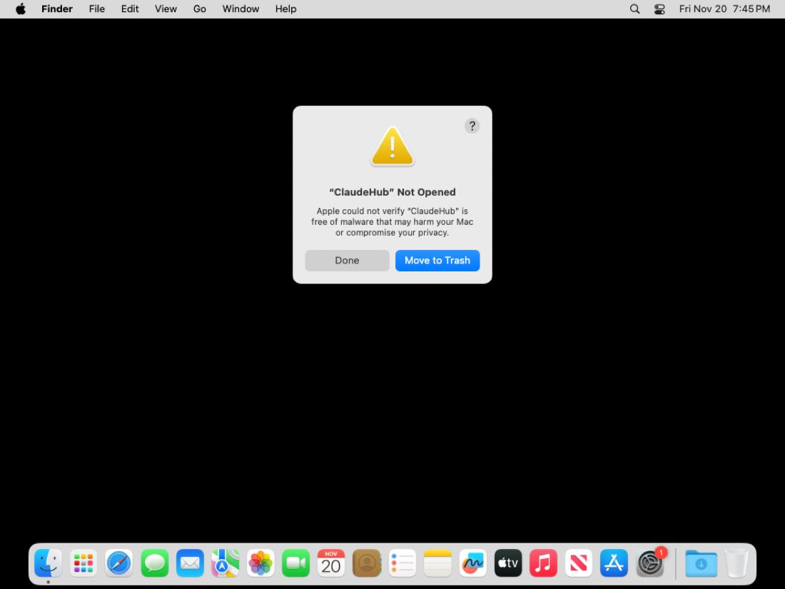
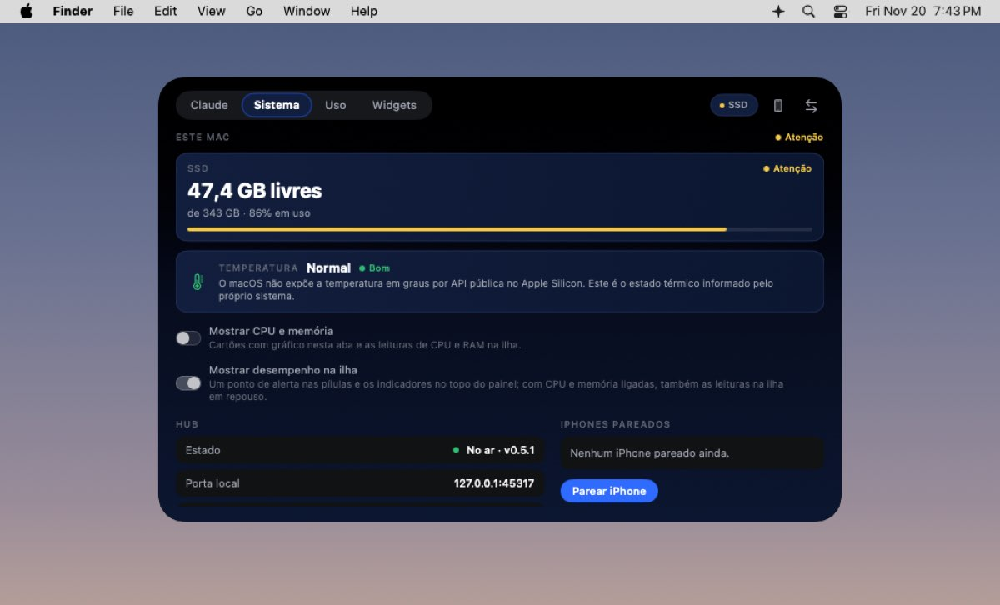
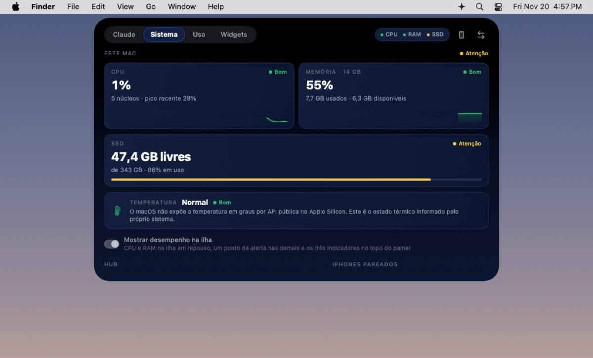
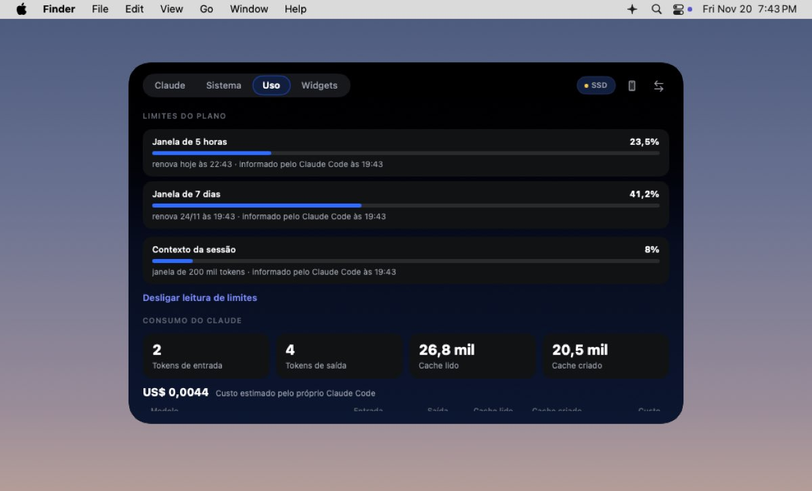

# Instalar o Claude Hub no Mac

Guia só com cliques: nada de Terminal, Xcode, Homebrew, Node ou Git. O aplicativo chega pronto — foi compilado, testado e empacotado no GitHub Actions.

> **Estado desta versão (0.5.2): não assinada nem notarizada.** A instalação é exercitada de ponta a ponta num Mac Apple Silicon virtual a cada mudança, mas **ainda não foi feita num MacBook de verdade**. A instalação só estará validada depois que funcionar no seu.

## Antes de começar

| Você precisa de | Observação |
|---|---|
| Mac com Apple Silicon (M1 ou mais novo) | macOS 14 (Sonoma) ou mais novo |
| Claude Code, Codex CLI ou OpenCode instalado | O assistente encontra cada um sozinho; Codex e OpenCode são opcionais |

**Leia antes de baixar — limitação conhecida.** Este instalador **não é notarizado pela Apple**, porque não há um certificado Apple Developer ID configurado (exige conta paga, US$ 99/ano). Por isso:

- **Ao abrir o app baixado, o macOS bloqueia.** Aparece o aviso *"ClaudeHub" Not Opened — Apple could not verify "ClaudeHub" is free of malware that may harm your Mac or compromise your privacy* (ou o equivalente em português), com apenas dois botões: fechar o aviso ou mover o app para o Lixo. Isso foi reproduzido no teste automatizado — a imagem abaixo é a tela real do Mac de teste.
- **Este projeto não desativa nem contorna essa verificação**, e este guia não traz nenhum passo para isso.
- **A solução é a notarização** (ver [`SIGNING_NOTARIZATION.md`](SIGNING_NOTARIZATION.md)): com ela o aviso deixa de existir. É um serviço pago da Apple; só avanço com a sua autorização.
- Enquanto não houver notarização, o único caminho que não mexe no Gatekeeper é a autorização **por aplicativo** que o próprio macOS oferece ao dono do Mac, em **Ajustes do Sistema → Privacidade e Segurança**, depois de uma tentativa de abertura bloqueada. É uma decisão sua. Eu não pude verificá-la num Mac real, nem ler a página de suporte da Apple a partir do ambiente em que trabalho.

Em resumo: **não posso afirmar que este instalador abrirá normalmente no seu Mac.** O que posso afirmar é o que foi medido: todo o resto da instalação funciona num Mac Apple Silicon de teste.

## 1. Baixar

| | |
|---|---|
| Link direto | <https://github.com/LabsKalox/Claude-Hub/releases/download/v0.5.2/ClaudeHub-0.5.2-arm64.dmg> |
| Arquivo | `ClaudeHub-0.5.2-arm64.dmg` |
| Versão | 0.5.2 |
| SHA-256 | na página do release e no arquivo `ClaudeHub-0.5.2-arm64.dmg.sha256` |
| Tamanho | 45 MB |
| Página do release | <https://github.com/LabsKalox/Claude-Hub/releases/tag/v0.5.2> |

Clique no link. O arquivo vai para a pasta **Downloads**.

## 2. Instalar

1. Dê dois cliques em `ClaudeHub-0.5.2-arm64.dmg`. Abre uma janela com o ícone **ClaudeHub** e um atalho **Applications**.
2. Arraste **ClaudeHub** para cima de **Applications**.
3. Feche a janela e ejete o disco "Claude Hub" (botão ⏏ na barra lateral do Finder).

Se já existe uma versão instalada, o Finder pergunta se deve **Substituir**: confirme. Suas configurações, pareamentos e histórico ficam.

## 3. Abrir

Abra o **Launchpad** (ou a pasta **Aplicativos**) e clique em **ClaudeHub**.

O app não aparece no Dock. Ele vive na **barra de menus** (ícone de estrela, no alto à direita) e na ilha no topo da tela. Na primeira vez, a janela **Claude Hub — Configuração** abre sozinha.

> **Com este build de teste, o macOS interrompe neste ponto** com o aviso mostrado no início do guia. O app só segue adiante se você, como dono do Mac, autorizar esse aplicativo na tela do próprio sistema (Ajustes do Sistema → Privacidade e Segurança) — decisão que este guia não toma por você. Com um instalador notarizado, esse aviso não aparece.

## 4. Configurar pelo assistente

A janela tem cinco blocos, de cima para baixo. Cada um mostra um ícone de estado e, no máximo, um botão principal.

| Bloco | O que você faz | O que acontece |
|---|---|---|
| **1. Aplicativo** | Nada | Confere se o app está em Aplicativos. Se você o abriu de dentro do `.dmg` ou de Downloads, ele pede para movê-lo e não configura nada |
| **2. Claude Code** | Nada | Mostra a versão e onde o Claude Code está instalado |
| **3. Serviço e hooks** | Clique em **Configurar agora** | Instala o serviço do hub (inicia com o Mac e reinicia sozinho) e liga o Claude Code ao hub |
| **4. Verificação de saúde** | Clique em **Verificar agora** | Testa a conexão com o hub, o recebimento de eventos e um pedido de aprovação de ponta a ponta |
| **5. iPhone** | Veja [`IPHONE_SETUP.md`](IPHONE_SETUP.md) | Liga o acesso seguro e mostra o QR Code de pareamento |

No rodapé: **Abrir no login** (liga para a ilha aparecer sempre que você entrar no Mac), **Atualizar** e **Desinstalar…**.

### O que o bloco 3 altera no seu Mac

| Onde | O quê |
|---|---|
| Configurações do Claude Code (`settings.json` na pasta `.claude` da sua pasta pessoal) | Acrescenta os hooks do Claude Hub. **Nada mais é tocado** |
| Itens de início do macOS | Registra o serviço do hub, só para o seu usuário |
| Pasta `.claude-hub` na sua pasta pessoal | Configuração, histórico e segredos locais |

Garantias, todas verificadas nos testes automatizados:

- **Suas configurações do Claude Code são preservadas por inteiro**: modelo, permissões e os seus próprios hooks ficam exatamente como estavam.
- **Um backup datado** do arquivo é gravado antes de qualquer alteração.
- **Nenhuma permissão é ampliada**: o assistente não muda o modo de permissão do Claude Code nem cria regras de "permitir".
- **Arquivo inválido não é tocado**: se as configurações não puderem ser lidas, o assistente para e avisa.
- **Repetir é seguro**: clicar de novo não duplica nem reescreve nada.
- **Sem senha de administrador**: nada é instalado fora da sua conta.

### Permissões que o macOS pode pedir

| Aviso do macOS | Por quê | O que fazer |
|---|---|---|
| "Item em segundo plano adicionado" | É o serviço do hub | Nada; é só um aviso |
| "Item de início adicionado" | Só se você ligar **Abrir no login** | Nada; é só um aviso |
| "ClaudeHub quer controlar Música" (ou Spotify) | Só se você clicar em voltar, pausar ou avançar no widget de música | Opcional. Sem aceitar, o widget continua mostrando a faixa, só não controla |

O Claude Hub **não pede** Acessibilidade, Gravação de Tela, Acesso Total ao Disco, Localização nem senha de administrador. Se algum desses pedidos aparecer, não aceite e me avise.

## 5. O que há na ilha

Clique na ilha (ou no ícone da barra de menus → **Abrir painel**) para expandir. São quatro abas:

| Aba | O que mostra | Precisa de quê |
|---|---|---|
| **Claude** | Sessões do Claude Code, estado de cada uma, pedidos de permissão e o seletor de aprovações | Bloco 3 do assistente |
| **Sistema** | CPU, memória usada e disponível, espaço no SSD, bateria e estado térmico, com gráficos e indicadores verde/amarelo/vermelho | Nada. Funciona sem internet e sem o Claude Code |
| **Uso** | Atividade do dia, limites do plano e consumo de tokens | Atividade: nada. Limites e consumo: ligar na própria aba (abaixo) |
| **Widgets** | Relógio e data, música tocando, clima | Clima: escolher a cidade na engrenagem do cartão e ter internet |

*Com "Mostrar CPU e memória" ligado (captura da 0.4.2):*

**Posição da ilha.** Por padrão ela fica um pouco abaixo do topo, para não cobrir a barra de abas de um navegador maximizado. Para mudar: ícone da barra de menus → **Posição da ilha** → *Colada no topo* (junto ao notch), *Abaixo das abas do navegador* (padrão) ou *Mais abaixo*. Para encaixar exatamente na linha da barra do seu navegador: **Ajustar altura da ilha…** → arraste o controle (ou use as setas de 1 pt); a ilha se move enquanto você ajusta.

**CPU e memória vêm ocultas.** A aba Sistema mostra SSD, bateria e estado térmico. Para ver os cartões de CPU e memória (com gráfico) e as leituras de CPU/RAM na ilha, ligue **Mostrar CPU e memória** na própria aba.

Três observações honestas:

- **Temperatura:** o macOS não informa a temperatura em graus para aplicativos no Apple Silicon. A ilha mostra o estado térmico oficial do sistema (Normal, Morno, Quente, Crítico).
- **Bateria:** o cartão só aparece em Macs com bateria. No Mac de teste (virtual) não havia; no seu MacBook deve aparecer — ainda não verificado.
- **Música:** aparece a faixa que começar a tocar no app Música ou no Spotify **depois** de o Claude Hub abrir.

### Limites e consumo do Claude (opcionais, desligados de fábrica)

Na aba **Uso**, dois botões: **Ligar leitura de limites** e **Ligar medição**. Cada um explica o que altera e pede confirmação.

| Opção | O que altera nas configurações do Claude Code | O que passa a aparecer |
|---|---|---|
| Leitura de limites | A linha de status passa por uma ponte do Claude Hub. Se você já tem uma linha de status, ela continua aparecendo igual | Percentual usado das janelas de 5 horas e 7 dias e quando reiniciam — **exatamente como o Claude Code informa** |
| Medição de consumo | Acrescenta variáveis de telemetria que apontam só para o hub neste Mac | Tokens de entrada, saída e cache, e o custo estimado pelo próprio Claude Code, por modelo |

- Um backup datado é gravado antes de cada alteração; **Desligar** devolve o arquivo exatamente como estava.
- **Nada é estimado pelo Claude Hub.** Se o Claude Code não informar um dado, a tela diz que não há dado. O Claude Code só informa limites em planos com limite por janela (Pro/Max), depois da primeira resposta de uma sessão.
- Os dados ficam neste Mac. Sessões abertas antes de ligar precisam ser reabertas.

*Captura do Mac de teste. Os percentuais de limite são um exemplo de teste no formato oficial do Claude Code, não uma conta real; os tokens e o custo vêm de uma sessão real.*

### Abrir junto com o Claude Code

Depois do bloco 3, a ilha **abre sozinha quando uma sessão do Claude Code começa**, se não estiver aberta. Não abre uma segunda ilha. Para desligar: aba **Widgets** → **Preferências** → **Abrir a ilha quando o Claude Code iniciar**. Para abrir também ao entrar no Mac: **Abrir no login**, no rodapé do assistente.

### Codex e OpenCode (opcional, desde a 0.5.0)

Na janela **Configuração e saúde…**, bloco **6. Codex e OpenCode**, ligue o agente que você usa. As sessões dele aparecem na ilha e no iPhone, e os pedidos de permissão chegam do mesmo jeito ("Codex quer usar Bash"). O pedido continua aparecendo também no terminal: quem responder primeiro decide.

| Agente | O que o Claude Hub faz | O que você precisa fazer |
|---|---|---|
| **Codex CLI** | Acrescenta hooks em `~/.codex/hooks.json` (os seus continuam; backup antes de gravar). O `config.toml` não é tocado | Na próxima sessão, o Codex mostra **Review hooks**: escolha confiar nos hooks do Claude Hub. Sem isso o Codex não os executa, por segurança — e o Claude Hub não pula essa etapa |
| **OpenCode** (V1 e V2) | Copia um plugin para `~/.config/opencode/plugins/claude-hub.js`. O `opencode.json` não é tocado | Abrir uma sessão nova do OpenCode |

Desligar no mesmo bloco desfaz tudo. **Desinstalar…** também remove as duas integrações.

> **Situação honesta:** o Codex e o OpenCode **não foram executados de verdade** nos testes — instalar esses programas não foi permitido no ambiente de desenvolvimento. Os testes usam os formatos tirados do código-fonte deles (Codex 0.171.0, OpenCode 1.19.6 e 2.3.2) contra o hub real. A primeira sessão de verdade é a sua.

## 6. Conferir que funciona de verdade

O bloco 4 prova que o encanamento funciona. Falta provar que o **seu Claude Code** fala com o hub:

1. Abra o Claude Code como você já faz, em qualquer projeto. Sessões abertas **antes** da configuração precisam ser fechadas e abertas de novo.
2. Peça algo que exija permissão — por exemplo, que ele rode o build do projeto.
3. A ilha deve mostrar **Trabalhando** e, em seguida, **Claude quer usar Bash · projeto**, com o comando completo e os botões **Negar** e **Permitir**.
4. Clique em **Negar**: o Claude deve dizer que o comando foi negado. Peça de novo e clique em **Permitir**: o comando roda.
5. Quando terminar, a ilha mostra **Terminou**.
6. No assistente, clique em **Verificar agora**: o item **Evento real de uma sessão do Claude Code** deve ficar verde.
7. Feche a ilha (ícone da barra de menus → **Sair do Claude Hub**), abra uma sessão nova do Claude Code: a ilha deve reaparecer sozinha.
8. Na aba **Sistema**, confira se CPU, memória, SSD e bateria batem com o que o Monitor de Atividade mostra.
9. Reinicie o Mac. Depois de entrar, o ícone da barra de menus não deve mostrar "Hub offline".

Só depois desses nove passos — e do iPhone — a instalação pode ser considerada validada.

## 7. iPhone

Bloco 5 do assistente. Passo a passo em [`IPHONE_SETUP.md`](IPHONE_SETUP.md).

## Diagnóstico, reparo e desinstalação

Tudo pela janela **Configuração e saúde…** (ícone da barra de menus).

| Preciso de | Onde clicar | O que faz |
|---|---|---|
| Saber se está tudo bem | Bloco 4 → **Verificar agora** | Sete checagens, cada uma com o resultado e o motivo |
| Mandar o estado da instalação para análise | Bloco 4 → **Copiar diagnóstico** | Copia um relatório em texto; cole numa mensagem. Não contém senhas nem tokens |
| Ver o que o hub registrou | Bloco 4 → **Abrir log do hub** | Abre o arquivo de log |
| Consertar a instalação | Bloco 3 → **Reparar** | Reinstala o serviço se preciso e regrava os hooks do Claude Hub |
| Tirar um aparelho | Bloco 5 → lista de aparelhos → **Revogar** | O aparelho perde o acesso na hora |
| Desinstalar | Rodapé → **Desinstalar…** | Veja abaixo |

**Desinstalar…** oferece duas opções:

- **Desinstalar e manter os dados** — remove os hooks do Claude Hub (os seus ficam), desliga o serviço e tira o app da abertura no login. O histórico e os pareamentos ficam guardados para uma reinstalação.
- **Desinstalar e apagar os dados** — o mesmo, e apaga também histórico, pareamentos e segredos locais.

Depois, aparece o botão **Mover o app para o Lixo e sair**.

## Atualizar

Baixe o `.dmg` novo e repita o passo 2, confirmando **Substituir**. Abra o app; se o bloco 3 pedir, clique em **Reparar**. Os aparelhos pareados continuam pareados.

## Se algo não funcionar

| O que aparece | O que fazer |
|---|---|
| "Arraste o Claude Hub para a pasta Aplicativos e abra de lá" | O app foi aberto do `.dmg` ou de Downloads. Mova para Aplicativos e abra de lá |
| A janela de configuração não abre | Clique no ícone de estrela na barra de menus → **Configuração e saúde…** |
| Ilha mostra "Hub offline" | Bloco 3 → **Reparar**. Se continuar, **Copiar diagnóstico** e me envie |
| A sessão do Claude Code não aparece | Feche e abra a sessão; depois **Verificar agora** |
| "Os hooks apontam para outra porta, outro token ou outro local" | **Reparar** |
| "Claude Code não encontrado" | Instale o Claude Code e clique em **Atualizar**. Os hooks já ficam prontos |
| O pedido aparece só no terminal | O modo "Só avisar" está ligado: clique na ilha → aba **Claude** → **Sempre aqui** |
| Bloco 5 diz "O Tailscale está instalado, mas não está conectado" com o Tailscale conectado | Era um defeito da 0.4.0 (o app não conseguia ler o estado do Tailscale). Atualize para a 0.4.3: seção **Atualizar** |
| Bloco 5 diz "não consegui ler o estado dele" | O bloco mostra a resposta que o Tailscale deu. Abra o Tailscale, confira se está conectado e clique em **Atualizar**. Se continuar, **Copiar diagnóstico** e me envie |
| Bloco 5 diz "o HTTPS está desativado na sua rede" | Clique em **Abrir o painel do Tailscale**, ative **HTTPS Certificates** na página DNS e clique em **Atualizar** |
| A ilha cobre as abas do navegador ou fica torta na linha da barra | Ícone da barra de menus → **Ajustar altura da ilha…** e mova até encaixar |
| No iPhone, "Ativar notificações" mostra uma mensagem de erro | Veja a tabela em [`IPHONE_SETUP.md`](IPHONE_SETUP.md), passo 4; depois **Copiar diagnóstico** e me envie |
| Qualquer outra coisa | **Copiar diagnóstico** e me envie o texto |

## O que foi e o que não foi verificado

**Executado no GitHub Actions** (Mac Apple Silicon virtual, macOS 15), a partir do mesmo `.dmg` do link acima: as quatro abas da ilha com dados reais (capturas neste guia); abertura automática da ilha pelo hook de início de sessão, sem duplicar; ligar e desligar limites e consumo preservando as configurações; instalação limpa; recusa de configurar de dentro do `.dmg`; serviço de inicialização; hooks gravados preservando um arquivo de configurações já existente; verificação de saúde; pedidos de aprovação negados, permitidos, repetidos, cancelados e de aparelho revogado; pareamento por código de uso único; recuperação do hub encerrado à força; reinstalação por cima; desinstalação mantendo e apagando os dados; abertura do app e da janela do assistente. Detalhes em [`TEST_REPORT.md`](TEST_REPORT.md).

**Não verificado** — depende do seu MacBook e do seu iPhone: o comportamento real do aviso do macOS para o app baixado; cliques na ilha e nos botões do assistente (o teste executa diretamente as mesmas ações que os botões disparam, mas não clica); notch e vários monitores; reinício do Mac; uma sessão interativa do Claude Code; limites vindos de uma sessão real; bateria; controles de música; busca de cidade no clima; Tailscale, QR Code e notificações no iPhone. A lista completa, item a item, está em [`FEATURE_MATRIX.md`](FEATURE_MATRIX.md).
