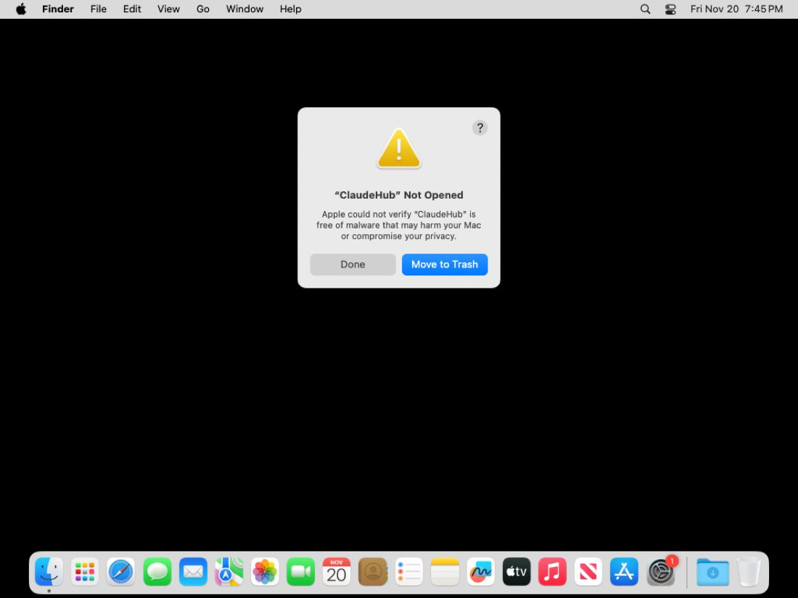

# Assinatura, notarização e Gatekeeper

Resumo: **não há certificado Apple Developer ID configurado**, então o instalador publicado é um **build de teste, não notarizado**. Baixado da internet, o macOS bloqueia a abertura do app — medido no CI, com captura de tela. Este projeto não desativa nem contorna essa verificação. Para um instalador que abre normalmente é preciso uma conta paga de desenvolvedor Apple; o pipeline já está pronto para ela.

## O que a Apple exige

Conferido em 20/11/2026 na documentação oficial (`developer.apple.com/documentation/security/notarizing-macos-software-before-distribution`, `…/customizing-the-notarization-workflow`, `…/resolving-common-notarization-issues`, `developer.apple.com/developer-id`, `developer.apple.com/programs`):

| Requisito | O que a Apple diz |
|---|---|
| Notarização é obrigatória fora da App Store | "Beginning in macOS 10.15, all software built after June 1, 2019, and distributed with Developer ID must be notarized." |
| Certificado | "Use a 'Developer ID' application … certificate for your code-signing signature. (Don't use a Mac Distribution, ad hoc, Apple Developer, or local development certificate.)" |
| Quem emite o certificado | "you must be the Account Holder of your development team in the Apple Developer Program" |
| Custo | Apple Developer Program: "$99 annual membership" |
| Hardened runtime | "Enable the Hardened Runtime capability for your app and command line targets" |
| Carimbo de tempo | "Include a secure timestamp with your code-signing signature" |
| Ferramenta | `notarytool` — "the Apple notary service no longer accepts uploads from altool" desde 1/11/2023 |
| Formatos aceitos | "disk images (UDIF format), signed flat installer packages, and ZIP archives"; o serviço gera tíquetes também para o conteúdo aninhado |
| Grampear o tíquete | "You should also attach the ticket to your software using the stapler tool … so that Gatekeeper can find the ticket even when a network connection isn't available" |
| Verificação antes de enviar | `codesign -vvv --deep --strict` |

**Não consegui ler daqui** as páginas de suporte ao usuário (`support.apple.com`), que descrevem o aviso exibido para apps não notarizados — o domínio está fora da rede permitida deste ambiente. O que digo abaixo sobre esse aviso vem do comportamento conhecido do macOS, não de uma leitura feita agora.

## O instalador de hoje e o instalador notarizado

Os dois são construídos inteiramente no GitHub Actions; nada é compilado no Mac de quem usa.

| | Instalador de hoje (build de teste) | Instalador notarizado |
|---|---|---|
| Como obter | Pré-lançamento no GitHub (link em `INSTALL_MACOS.md`) | O mesmo fluxo, depois de configurar os segredos abaixo |
| Assinatura do app | Local (ad-hoc), sem Developer ID | Developer ID + hardened runtime + carimbo de tempo |
| Assinatura do `.dmg` | Nenhuma | Developer ID |
| Node embutido | Binário oficial, assinatura original da Node.js Foundation (`HX7739G8FX`) | Reassinado com o seu Developer ID |
| Notarizado | **Não** | Sim, com tíquete grampeado no `.dmg` |
| Ao abrir o app baixado | **O macOS bloqueia** | Abre normalmente (esperado; não verificado) |
| Custo | Nenhum | US$ 99/ano (Apple Developer Program) |

### O que foi medido com o instalador de hoje

`tests/real/macos-gatekeeper-check.mjs` roda no CI depois dos testes de instalação. Ele marca uma cópia do `.dmg` com o atributo de quarentena que o navegador grava em todo download, e registra o que o macOS responde — sem remover a quarentena, sem alterar políticas e sem aprovar nada.

| Verificação | Resultado (macOS 15.8.2, Apple Silicon) |
|---|---|
| Gatekeeper no Mac de teste | Ativo (`assessments enabled`) |
| `.dmg`: assinatura / tíquete grampeado | Sem assinatura / sem tíquete |
| `.dmg`: `spctl --assess --type open` | `rejected — source=no usable signature` |
| App copiado do `.dmg` herda a quarentena | Sim (o Node embutido também) |
| App: `spctl --assess --type execute` | `rejected` |
| Abrir o app com duplo clique | **Bloqueado.** Aviso *"ClaudeHub" Not Opened — Apple could not verify "ClaudeHub" is free of malware…*, botões **Done** e **Move to Trash**; nenhuma janela do app na tela |
| Node embutido, em quarentena, executa | Sim (binário oficial assinado; é ele que roda o hub) |

### O que isso significa para você

- **Não afirmo que o instalador de hoje abre normalmente.** No Mac de teste ele não abriu com duplo clique.
- O macOS oferece ao dono do Mac uma autorização **por aplicativo** em **Ajustes do Sistema → Privacidade e Segurança**, depois de uma abertura bloqueada. Isso é uma função do próprio Gatekeeper, que exige a sua confirmação; usá-la é decisão sua. Não a verifiquei num Mac real.
- O que este projeto **não** faz, nem recomenda: remover o atributo de quarentena, desativar o Gatekeeper, ou qualquer comando ou script que libere o app sem passar pela tela do sistema.

## Como ativar a notarização

Depois de entrar no Apple Developer Program:

1. **Certificado.** Em `developer.apple.com/account` → Certificates, o titular da conta cria um certificado **Developer ID Application**. Exporte-o do app Acesso às Chaves como `.p12` com senha.
2. **Chave da API.** Em App Store Connect → Usuários e Acessos → Integrações → App Store Connect API, crie uma chave de equipe e baixe o arquivo `.p8`. Anote o *Key ID* e o *Issuer ID*.
3. **Segredos do repositório** (GitHub → Settings → Secrets and variables → Actions):

| Segredo | Conteúdo |
|---|---|
| `MACOS_CERTIFICATE_P12_BASE64` | `base64 -i certificado.p12` |
| `MACOS_CERTIFICATE_PASSWORD` | senha do `.p12` |
| `MACOS_SIGNING_IDENTITY` | `Developer ID Application: Seu Nome (TEAMID)` |
| `APPLE_API_KEY_P8_BASE64` | `base64 -i AuthKey_XXXX.p8` |
| `APPLE_API_KEY_ID` | Key ID |
| `APPLE_API_ISSUER_ID` | Issuer ID |

4. Rode o workflow **CI macOS**. Com os segredos presentes, ele:
   - importa o certificado para um chaveiro temporário do runner;
   - assina o Node embutido e o app com Developer ID, hardened runtime e carimbo de tempo (`build-app.sh`);
   - assina o `.dmg`, envia com `xcrun notarytool submit --wait`, grampeia com `xcrun stapler staple` e valida (`package-dmg.sh`).

## O que está e o que não está verificado

| Item | Situação |
|---|---|
| Build ad-hoc: app, Node embutido e `.dmg` íntegros (`codesign --verify --deep --strict`) | Verificado no CI a cada execução |
| Node embutido é o binário oficial (SHA-256 fixado no script, assinatura original válida) | Verificado no CI |
| Caminho Developer ID + notarização | **Escrito, nunca executado**: não há certificado nem chave. A primeira execução com segredos reais pode exigir ajustes |
| Aceitação, pelo serviço de notarização, do Node reassinado com as duas permissões de JIT | **Não verificado** |
| Abertura do `.dmg` notarizado num Mac sem aviso | **Não verificado** |
| Bloqueio do build de teste baixado | **Verificado no CI** (veredito do `spctl` e captura do aviso) |
| Autorização por aplicativo em Ajustes do Sistema | **Não verificado** (exige interação humana num Mac real) |
| O app e o Node embutido funcionando depois dessa autorização | **Não verificado** |

## Por que o app não usa sandbox

A ilha precisa ler `~/.claude-hub/config.json`, executar o Node embutido e registrar um serviço em `~/Library/LaunchAgents`. Isso é incompatível com o App Sandbox, que só é obrigatório na Mac App Store. Fora dela, o hardened runtime e a notarização são os controles exigidos — e o app não pede Acessibilidade, Gravação de Tela nem acesso total ao disco.
