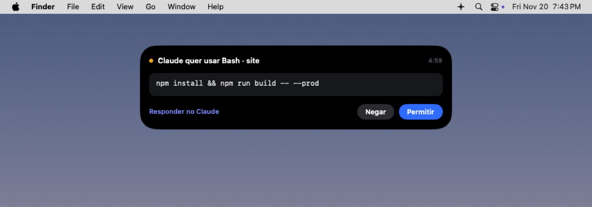
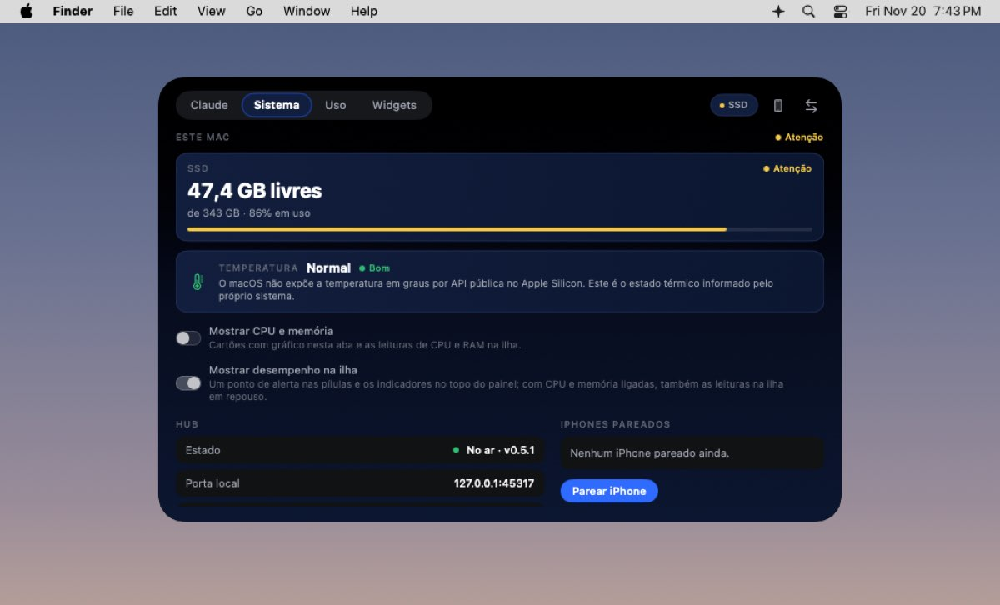
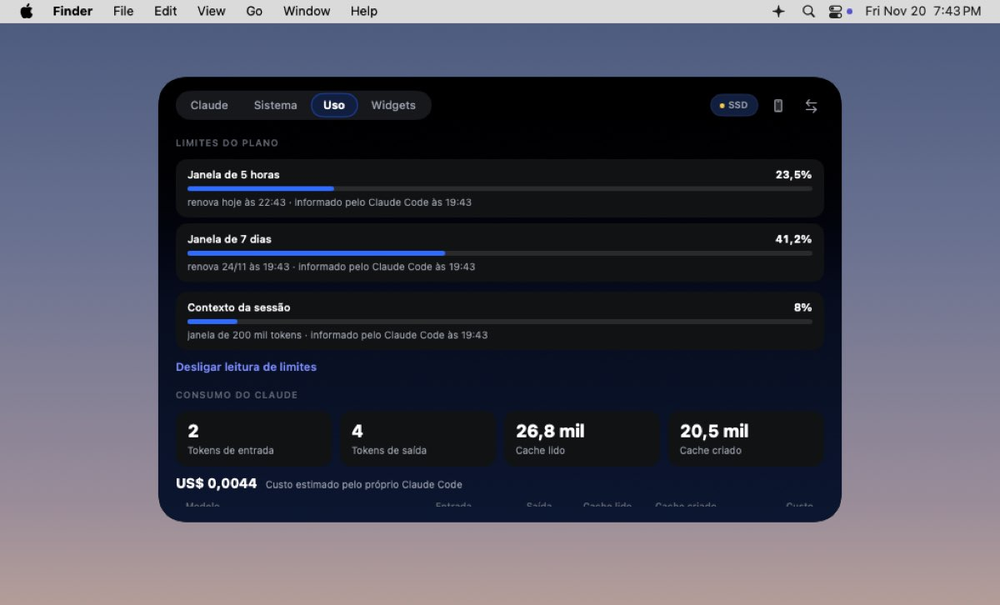
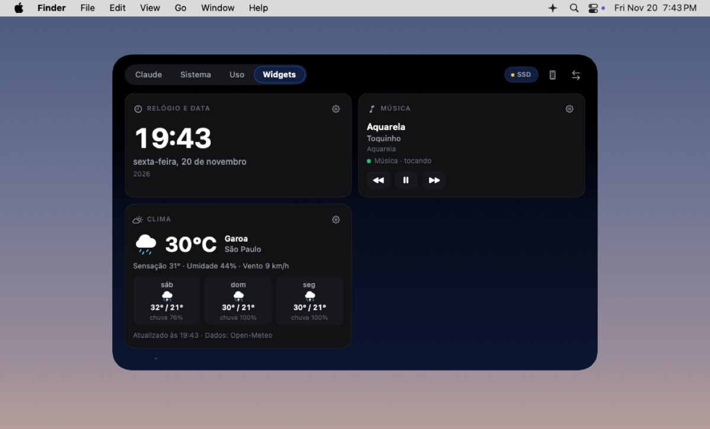
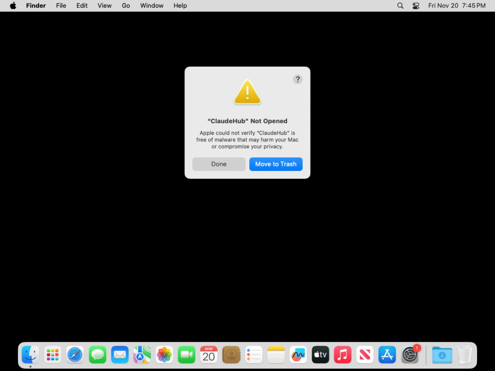

# Relatório de testes

Data: 20/11/2026 · Branch: `claude/claude-hub-macos-iphone-ddwmvq`

## Resumo

Versão 0.5.1 — **não assinada nem notarizada**. A situação de cada funcionalidade do escopo, uma a uma, está em [`FEATURE_MATRIX.md`](FEATURE_MATRIX.md). Toda a compilação, os testes e o empacotamento acontecem no GitHub Actions; nada é compilado no Mac de quem usa. O que segue é o que foi de fato executado; o que depende do seu MacBook e do seu iPhone está na seção 8 e **não** deve ser considerado validado.

| Camada | Como foi testada | Resultado |
|---|---|---|
| Integração com o Claude Code | Sessões reais do Claude Code 2.1.329 + payloads reais como fixtures | **Funciona** |
| **Integração com o Codex CLI** | Codex 0.171.0 real (app-server), macOS e Linux, 2 sessões simultâneas, permitir e negar (seção 1.3) | **Funciona** — sem consumo/limites, erro ou progresso |
| **Integração com o OpenCode** | OpenCode 1.19.6 e 2.3.2 reais (`opencode serve`), macOS e Linux, 2 sessões simultâneas, permitir e negar (seção 1.3) | **Funciona** — sem consumo/limites |
| Aprovação remota (permitir e negar) | Claude Code real + hub real + "celular" pela porta do iPhone, inclusive com o runtime empacotado | **Funciona** |
| Hub local | 89 testes de integração e segurança (servidores e WebSocket reais) | **Passou** |
| Push: subject VAPID aceito pela Apple | Sonda no GitHub Actions contra `web.push.apple.com`, com chaves descartáveis e aparelho inventado | **Medido** (seção 5.7): o subject antigo é recusado com 403 BadJwtToken; o novo é aceito |
| Push: "Ativar notificações" num iPhone real | — | **Não funciona na 0.4.0 e a causa não foi identificada.** A 0.4.3 instrumenta cada etapa; a correção depende do relato do aparelho |
| Consumo do Claude (tokens e custo) | Claude Code real exportando telemetria para o hub; métricas reais como fixture | **Funciona** — custo medido pelo hub = custo impresso pelo Claude Code |
| Limites do plano | Exemplo da documentação oficial da linha de status, passado pela ponte instalada | **Passou**; **nunca recebido de uma sessão interativa real** |
| Bridge (estados, hooks, serviço, detecção, hook de comando, preferências, túnel do iPhone) | 83 testes | **Passou** |
| Contratos | 13 testes | **Passou** |
| PWA (com a aba Uso), ilha web, pareamento por QR e ativação de notificações | 25 testes ponta a ponta em Chromium contra um hub real (também contra o runtime empacotado) | **Passou** |
| Imagem Docker | Build + contêiner em execução, aqui e no CI | **Passou** |
| App macOS — compilação e testes do núcleo | GitHub Actions, runner `macos-15` arm64, Xcode 16.4 | **Passou** |
| App macOS — execução | Fumaça no runner macOS (app real + hub real) | **Passou** (abre, conecta, renderiza todos os estados e as abas Sistema, Uso e Widgets) |
| Monitor do Mac, widgets, abertura automática | Fumaça e teste de instalação no runner macOS | **Passou** (seções 4 e 5); bateria, controles de música e cliques **não verificados** |
| **Instalador `.dmg` — instalação limpa, reinstalação, aprovações, desinstalação** | Runner macOS 15 Apple Silicon, a partir do `.dmg` | **Passou** (seção 5) |
| **Gatekeeper com o instalador baixado** | Cópia do `.dmg` marcada como download; veredito do macOS registrado | **Bloqueia o app**, como esperado para um build sem notarização (seção 7) |
| Assinatura Developer ID e notarização | — | **Não executado** (sem certificado Apple Developer ID) |
| MacBook físico — hub, serviço, hooks e evento real do Claude Code | Diagnóstico gerado no MacBook do usuário (macOS 15.5) | **Funciona** (diagnóstico do autor, não publicado) |
| MacBook físico — ilha compacta na tela | Captura enviada pelo usuário (estado Trabalhando) | **Aparece** (captura do autor, não publicada) |
| MacBook físico — cliques, painel expandido, notch, reinício | — | **Sem evidência ainda** |
| iPhone real (Tailscale, instalação, QR, push) | — | **Não testado** |

## 1. Integração real com o Claude Code

### 1.1 Captura de payloads
Uma sessão real (`claude -p`, modelo Haiku) rodou com hooks de sonda. Constatações:

- Hooks HTTP funcionam, com cabeçalho `Authorization` literal.
- `SessionStart` **não** dispara em hook HTTP, só em hook de comando — por isso o instalador usa um hook de comando para esse evento.
- Sequência observada: `SessionStart → UserPromptSubmit → PreToolUse → PostToolUse → PreToolUse → PostToolUse → Stop → SessionEnd`.

Os oito payloads estão em `tests/fixtures/real-session-claude-code-2.1.329.jsonl` (caminhos anonimizados) e alimentam os testes da máquina de estados.

### 1.2 Aprovação remota de ponta a ponta
Script: `node tests/real/run-real-claude.mjs allow|deny`. Ele sobe o hub, instala os hooks com a CLI do projeto, roda o Claude Code real pedindo `touch <arquivo>`, pareia um dispositivo pela porta do iPhone e responde por ela.

| Decisão | O que o hub registrou | O que o Claude Code fez | Evidência |
|---|---|---|---|
| Permitir | sessão em `APPROVAL_REQUIRED`, pedido criado, `approval.allowed` por `dev_…` | executou; arquivo criado | `docs/evidence/real-claude-allow.txt` |
| Negar | idem, `approval.denied` | não executou; respondeu que o Claude Hub negou | `docs/evidence/real-claude-deny.txt` |

Nos dois casos a cadeia de auditoria foi verificada como íntegra.

**Limite:** essas execuções usam `claude -p` (não interativo). A sessão interativa em terminal não foi exercitada — o Claude Code deste ambiente pede configuração inicial que não cabia alterar.

### 1.3 Codex CLI e OpenCode reais (0.5.1)

Workflow `Agentes reais` (`.github/workflows/agents-e2e.yml`, script `tests/real/agents-e2e.mjs`), execução [44805667291](https://github.com/LabsKalox/Claude-Hub/actions/runs/44805667291): **6 de 6 aprovados** — Codex CLI 0.171.0, OpenCode 1.19.6 e OpenCode 2.3.2, cada um em `macos-15` e `ubuntu-latest`.

Como funciona cada execução:

1. HOME temporário; hub do runtime empacotado (o mesmo do `.dmg`); um "iPhone" pareado pela porta do iPhone.
2. A integração é ligada pela CLI do app (`claude-hub agents set <agente> on`) — o mesmo caminho do assistente.
3. O agente real é apontado para um **modelo falso local** (`tests/real/fake-model.mjs`, dialetos Chat Completions e Responses da OpenAI). Sem chave de API, sem custo. O roteiro manda o agente executar `echo hub-ok > hub-test.txt`.
4. Duas sessões ao mesmo tempo, em dois projetos: `projeto-permitir` e `projeto-negar`.
   - Codex: via `codex app-server` (JSON-RPC), com política `on-request`. A confiança nos hooks é dada pela própria API do Codex (`hooks/list` + `config/batchWrite`), o mesmo efeito da tela "Review hooks".
   - OpenCode: via `opencode serve` (1.x: `/session`; 2.x: `/api/session` com autenticação).
5. O "iPhone" permite um pedido e nega o outro.

Verificado em cada execução:

- sessões dos dois projetos marcadas com o agente certo;
- pedidos de permissão com o comando completo;
- **permitido → o arquivo foi criado; negado → o arquivo não existe**;
- as sessões são independentes;
- ao terminar, a sessão sai de "Trabalhando";
- ferramentas usadas no histórico;
- desligar a integração pela CLI.

Defeitos encontrados por esse teste e corrigidos antes do release:

- **Codex:** a política `untrusted` não existe mais na 0.171.0 e `codex exec` força aprovação "never". O teste passou a usar o app-server.
- **OpenCode 1.x:** `opencode run` rejeita permissões sozinho e duas execuções simultâneas travam o banco ("database is locked"). O teste passou a usar `opencode serve`.
- **OpenCode 2.x:**
  - as ações se chamam `shell`/`subagent` (o plugin passou a mapeá-las);
  - o fim da execução é anunciado por `session.execution.succeeded`, não por `session.idle`. A sessão ficava "Trabalhando" e foi corrigida na 0.5.1.

Limites: o modelo é falso, então o teste não mede consumo. A tela "Review hooks" do Codex e o terminal interativo do OpenCode não foram operados por uma pessoa. Nenhum dos dois rodou num MacBook físico.

## 2. Testes automatizados

```bash
pnpm build && pnpm test      # 185 testes
pnpm test:e2e                # 25 testes
```

### Hub — `services/api/test` (89)
- **Hooks e estado:** token de hook obrigatório; token local não envia hooks e vice-versa; payload inválido rejeitado; várias sessões simultâneas; resposta vazia a eventos comuns; fim de sessão.
- **Aprovação:** hook retido até a decisão; `allow` e `deny` no formato oficial; a resposta nunca carrega `updatedInput`/`updatedPermissions`; decisão duplicada → 409 (inclusive duas simultâneas); id errado não afeta o pedido; decisão inválida → 400; conexão fechada pelo Claude Code cancela o pedido; `PostToolUse` da mesma chamada cancela; pergunta do Claude não vira aprovação; "Só avisar" não retém; nenhum modo aprova sozinho.
- **Expiração:** pedido expira, devolve o controle ao terminal e recusa decisão tardia.
- **Roteamento:** "Sempre aqui" envia ao celular com link para o pedido exato; "Automático" só envia quando você está longe (chave ligada ou Mac ocioso).
- **Portas:** a porta do iPhone não expõe hooks nem administração; token local não vale nela; toda a API exige autenticação.
- **Pareamento:** uso único; aceita minúsculas e sem hífen; cinco erros matam o código; rajada bloqueada; código novo invalida o anterior; token guardado só como hash; revogação imediata.
- **Auditoria:** criação e decisão vinculadas à sessão e ao pedido; adulteração e remoção detectadas.
- **WebSocket:** fecha sem token; nada antes da autenticação; snapshot e mensagens ao vivo; presença do app macOS.
- **Push:** só dispositivos pareados assinam; endpoint precisa ser https.
- **Consumo e limites (`consumption.test.ts`):** métricas OpenTelemetry reais do Claude Code 2.1.329 somadas por modelo e tipo de token; temporalidade delta e cumulativa; reenvio não conta em dobro; custo ausente continua ausente (não vira zero); limites guardados exatamente como informados; janela já reiniciada some; preferência desligada → nenhum número; rotas exigem o token de hook e não existem na porta do iPhone.
- **Push (`push.test.ts`):** subject VAPID local é inválido e o padrão novo é válido; a migração mantém as chaves e troca só o subject; `push.subscribed` uma vez só, `push.unsubscribed`, `push.sent`, `push.failed` com status HTTP e motivo da Apple; inscrição vencida (410) removida; erro de rede sem status; **nem o endereço da inscrição nem as chaves do aparelho aparecem em log ou auditoria**; um pedido de aprovação gera um envio registrado; o relato do iPhone (`push.client`) é validado, cortado e tem URLs removidas; só aparelho pareado relata; o estado do push não existe na porta do iPhone.
- **Diagnóstico:** relatório em texto com estado e saúde, sem tokens; segredos que apareçam no log são ocultados.
- **Configuração e saúde (`setup.test.ts`):** hooks instalados preservando modelo, permissões e hooks do usuário, com backup; nenhuma permissão ampla acrescentada; idempotência; `settings.json` inválido não é sobrescrito; desinstalação remove só o que é do hub; autoteste passa com tudo configurado; **o pedido do autoteste é sempre negado e nunca vira "permitido"**; não gera push nem conta como evento real; detecta hooks ausentes, hub fora do ar e token divergente; versões de hub, CLI e pacote iguais.

### Bridge — `packages/claude-bridge/test` (83)
- Máquina de estados: todas as transições, progresso por lista de tarefas, subagentes, retomada de sessão, eventos desconhecidos, payloads malformados, **sessão real completa**.
- Instalador: hook HTTP com token, sem falha fechada; `SessionStart` por comando; `--minimal`; preserva hooks e configurações alheias; idempotente; reinstalar substitui; backup.
- Serviço: o plist executa só o Node com o hub, sem shell, com reinício automático; caminhos com caracteres especiais.
- Detecção: Claude Code (com e sem `--version`), Tailscale conectado/publicando/desconectado/saída inesperada; hooks atuais ou desatualizados (token, porta, app movido); backups datados; app fora de Aplicativos ou translocado.
- Preferências (`prefs.test.ts`): ligar a medição acrescenta só as variáveis de telemetria, apontando para 127.0.0.1; telemetria que já era do usuário não é sobrescrita (recusa e explica); ligar limites embrulha a linha de status existente e a restaura ao desligar; desligar devolve o arquivo original; desinstalar remove tudo.
- Ponte da linha de status (processo real): repassa `rate_limits` ao hub e imprime a linha de status original do usuário; sem linha original, imprime um resumo; hub fora do ar não quebra a linha.
- Hook de comando (processo real): repassa com token e informa o terminal; devolve o JSON do hub; hub fora do ar → código 0 e saída vazia; erros do hub não chegam ao Claude Code.

### Ponta a ponta — `tests/e2e` (25)
Um hub de verdade sobe em processo separado; o navegador usa a PWA exportada; os eventos entram pela mesma rota que o Claude Code usa.

- **iPhone (393×852):** pareamento por código; quatro sessões; pedido aparece, **Permitir** devolve `allow` ao hook; **Negar** devolve `deny` e entra no histórico; pedido respondido no terminal some; link de notificação de pedido já respondido explica o motivo; detalhe da sessão com progresso e eventos; ajustes chegam ao hub; **aba Uso**: com as preferências desligadas não mostra número nenhum, e com dados mostra os limites e o consumo exatamente como informados (`iphone-09-uso.png`); dispositivo revogado volta ao pareamento; sem token, nenhum dado.
- **Pareamento por QR:** abrir o link do QR pareia sozinho e o código não serve duas vezes; no Safari do iPhone a página orienta a instalar e o manifesto leva o código ao app; app já pareado que abre na URL antiga segue direto; parâmetro malformado não entra no manifesto nem na página.
- **Ilha web (1280×720):** "Trabalhando" com 70%; "Esperando você / Responder"; "Terminou"; pedido de permissão com **Negar**; painel com quatro sessões e seletor; decisão no iPhone fecha o pedido na ilha; hub fora do ar → "Hub offline".

Capturas geradas por esses testes: `docs/screenshots/`.

## 3. Fidelidade visual

Comparação entre os frames de referência e as capturas da interface real (web):

| Frame | Captura | Avaliação |
|---|---|---|
| 00:05 painel | `ilha-05-painel-de-sessoes.png` | Estrutura, textos, cores e hierarquia iguais. Proporções aproximadas |
| 00:08 trabalhando | `ilha-01-trabalhando.png` | Igual em composição (ícone, rótulo, pontos, anel, %) |
| 00:10 esperando | `ilha-02-esperando-voce.png` | Igual |
| 00:13 pedido | `ilha-04-pedido-de-permissao.png` | Igual; acrescenta a contagem de expiração |
| 00:16 iPhone | `iphone-03-pedido-de-permissao.png` | Cartão igual; fica dentro do app, não na tela de bloqueio |
| 00:20 conclusão | `iphone-04-tarefa-concluida.png` | Mesmo formato; título "Terminou · projeto" |

A comparação foi visual, lado a lado — não houve medição pixel a pixel, e a referência é uma folha de frames reduzidos. A ilha **nativa** foi fotografada em execução no CI macOS (seção 4): mesma composição, textos e cores. O que falta conferir num Mac real é o comportamento — animações, notch e interação.

## 4. App macOS

Não há compilador Swift no ambiente de desenvolvimento (Linux). Toda a verificação do app nativo acontece no workflow `CI macOS` (`.github/workflows/ci-macos.yml`), em runner `macos-15` com Xcode 16.4.

| Etapa | O que prova | Resultado |
|---|---|---|
| `swift build` | Os dois módulos (núcleo e app SwiftUI/AppKit) compilam | Passou |
| `swift test` | 85 testes do núcleo: decodificação de todas as mensagens do hub, redutor de estado, prioridade de foco, formatadores, configuração, limiares dos indicadores (verde/amarelo/vermelho), histórico dos gráficos, modelos de consumo/limites e de clima | Passou |
| `xcodebuild -project ClaudeHub.xcodeproj` | O projeto Xcode escrito à mão abre e compila (`** BUILD SUCCEEDED **`), incluindo o catálogo de ícones | Passou |
| `scripts/build-app.sh` | Monta e assina `ClaudeHub.app` só com as Command Line Tools | Passou; app publicado como artefato `ClaudeHub-app` |
| Fumaça (`tests/real/macos-smoke.mjs`) | O app compilado abre, lê a configuração, autentica no hub e percorre os estados | Passou — ver abaixo |

### Teste de fumaça: a ilha nativa em execução

`tests/real/macos-smoke.mjs` roda no runner macOS depois do build: sobe o hub, abre o `ClaudeHub.app` recém-compilado, espera o app autenticar por WebSocket, envia eventos de hook e captura a tela em cada estado. Resultado da última execução:

```
✓ app nativo abriu, leu a configuração e autenticou no hub por WebSocket
✓ captura 01-sem-sessoes
✓ captura 02-trabalhando
✓ captura 03-esperando-voce
✓ captura 04-pedido-de-permissao
✓ captura 05-terminou
✓ captura 06-painel-de-sessoes
✓ captura 10-aba-sistema
✓ hub entrega consumo e limites para a aba Uso
✓ captura 11-aba-uso
✓ captura 12-aba-widgets
Consumo do app com 4 sessões ativas: CPU 0.2% · memória 82 MB
✓ app continua em execução depois de todos os estados
✓ app continua conectado ao hub
RESULTADO: OK
```

O teste também alimenta as abas novas com dados de verdade: o monitor lê a própria máquina do CI; a aba Uso recebe as métricas reais do Claude Code 2.1.329 (fixture) e um exemplo de limites no formato oficial; o widget de clima busca São Paulo no Open-Meteo; o widget de música recebe uma notificação no formato que o app Música emite.

Capturas reais da ilha nativa (macOS 15, tela de 1024×768 do runner), em `docs/screenshots/macos/`:

| Estado | Captura |
|---|---|
| Sem sessões | `01-sem-sessoes.jpg` |
| Trabalhando · 70% | `02-trabalhando.jpg` |
| Esperando você / Responder | `03-esperando-voce.jpg` |
| Pedido de permissão | `04-pedido-de-permissao.jpg` |
| Terminou | `05-terminou.jpg` |
| Painel de sessões (aba Claude) | `06-painel-de-sessoes.jpg` |
| Aba Sistema: CPU, memória, SSD, estado térmico, indicadores | `10-aba-sistema.jpg` |
| Aba Uso: limites do plano e consumo | `11-aba-uso.jpg` |
| Aba Widgets: relógio, música, clima | `12-aba-widgets.jpg` |







*Na captura da aba Uso, os limites (23,5% e 41,2%) são o exemplo de teste; os tokens e o custo são os de uma sessão real do Claude Code 2.1.329.*



**O que as capturas das abas não provam:** o Mac do CI não tem bateria (o cartão de bateria nunca foi visto); a temperatura é o estado térmico do sistema, não graus; a música veio de uma notificação de teste, não do app Música tocando, e os botões de controle não foram clicados; a cidade do clima foi gravada nas preferências pelo teste, não digitada na interface; as abas foram abertas por comando, não por clique.

**O que esse teste não cobre:** ninguém clicou em nada. Clique em Negar/Permitir, hover, clique-através fora da ilha, "Responder" trazendo o terminal para a frente, encaixe no notch (o runner não tem notch), vários monitores e o início com o sistema continuam sem verificação. O caminho de decisão em si (`POST /api/approvals/:id/decision`) é o mesmo coberto pelos testes do hub e pela ilha web.

## 5. Instalação a partir do `.dmg`

Workflow `CI macOS`, execução 44793612454 (repositório de desenvolvimento, privado) (commit `ed84023`) — runner `macos-15`, **Apple M2 Pro (Virtual), arm64, macOS 15.8.2**. O `.dmg` testado é o mesmo arquivo publicado no pré-lançamento.

### 5.1 O instalador

| Item | Valor |
|---|---|
| Link direto | <https://github.com/LabsKalox/Claude-Hub/releases/download/v0.5.0/ClaudeHub-0.5.0-arm64.dmg> (exige login no GitHub; repositório privado) |
| Página do pré-lançamento | <https://github.com/LabsKalox/Claude-Hub/releases/tag/v0.5.0> |
| Também como artefato | `ClaudeHub-macOS-arm64` — (artefato de uma execução do repositório de desenvolvimento, privado) (zip com o `.dmg`; expira em 20/12/2026) |
| Versão | 0.5.0 |
| SHA-256 do `.dmg` | `b7384023ef464e434a780cc5b0bdc2fad2d8096a35a7c08bc7092aa8241631be` |
| Arquitetura | arm64 (app e Node) |
| Conteúdo do app | Ilha, hub, CLI, hook, ponte da linha de status, PWA, assistente e Node v22.23.5 oficial (SHA-256 do pacote fixado e conferido no build; assinatura original da Node.js Foundation válida) |
| Assinatura do app | Local (ad-hoc), sem Developer ID |
| Notarizado | **Não** |

### 5.2 O que `tests/real/macos-install-test.mjs` fez e conferiu

O teste usa só o que vem dentro do `.dmg` e roda a CLI embutida — a mesma que os botões do assistente chamam. Foram **103 verificações, todas aprovadas**; a transcrição completa está em `docs/evidence/macos-install-test.txt`.

| Etapa | Verificações (todas passaram) |
|---|---|
| 1. Instalação limpa | A imagem monta; contém o app e o atalho para Aplicativos. **Aberto de dentro do `.dmg`, o assistente se recusa a configurar** e não instala nada. Cópia para `/Applications` |
| 2. Conteúdo | Binários arm64; `codesign --verify --deep --strict` íntegro; Node com assinatura original intacta; arquivos do runtime presentes |
| 3. Antes de configurar | O app se reconhece em `/Applications`; nada configurado; **Claude Code detectado**; enxerga o hook que já era do usuário |
| 4. Configuração | Serviço `launchd` carregado, rodando **só o Node embutido com o hub**; segredos com permissão 600; **modelo, permissões e hook do usuário intactos**; nenhuma permissão ampla acrescentada; backup datado; rodar de novo não muda nada e não reinicia um hub saudável; reinstalar o serviço três vezes seguidas mantém o hub no ar |
| 5. Saúde | Hub, canal em tempo real, recebimento de evento, pedido de aprovação de ponta a ponta (negado), hooks e Claude Code — todos OK; "evento real" corretamente pendente |
| 6. Hooks e **aprovações** | Hooks disparados como estão gravados no `settings.json`. Pedido retido; QR de pareamento; porta do iPhone exige autenticação; código de uso único. **Negar** pelo aparelho chega ao hook; **permitir** devolve exatamente `{"behavior":"allow"}`; permitir um pedido anterior já negado é recusado; mudar de ideia depois de decidir é recusado; pedido respondido no terminal é cancelado; aparelho revogado perde o acesso; auditoria íntegra |
| 7. Resiliência | Hub morto com `kill -9` volta sozinho; as sessões sobrevivem (SQLite) |
| 8. App instalado | Abre pelo LaunchServices; conecta ao hub do serviço; assistente e verificação de saúde abertos e fotografados |
| 8b. **Abertura automática** | Com a ilha fechada, o hook de início de sessão **gravado no `settings.json`** é executado como o Claude Code faz: termina na hora e a ilha abre. Mais duas sessões e um novo duplo clique: continua **uma só instância**. Com a preferência desligada, a ilha não abre |
| 8c. **Consumo e limites** | O usuário de teste já tem variável de ambiente e linha de status próprias. Ligar a medição acrescenta só as variáveis de telemetria, apontando para o hub local; ligar os limites faz a linha de status passar pela ponte **e a linha do usuário continua saindo igual**; o hub mostra o consumo (métricas reais do Claude Code) e os limites exatamente como informados; **desligar as duas devolve o `settings.json` byte a byte** |
| 8d. **Tailscale visto de dentro do app** | O Node embutido é chamado direto, sem shell (como o app e o serviço fazem), contra um Tailscale de mentira que só responde como CLI com `TAILSCALE_BE_CLI=1`: conectado é reconhecido como conectado; HTTPS desativado é percebido e "Ativar acesso" explica o passo sem tentar publicar; resposta ilegível vira "não consegui ler", com o texto real |
| 8e. **Notificações** | Um `config.json` com o subject antigo (local) é migrado ao subir, **com as mesmas chaves**; o comando `push` informa subject, aparelhos e inscrições; a verificação de saúde avisa do aparelho pareado sem inscrição; o diagnóstico traz a seção de notificações, sem as chaves |
| 8f. **Codex e OpenCode** | Ligar o Codex grava os hooks em `hooks.json` apontando para o app e preserva o hook do usuário; ligar o OpenCode copia o plugin; o arquivo do plugin carrega e só exporta o plugin (entradas V1 e V2); um evento no formato do Codex, disparado pelo comando gravado, chega ao hub marcado como Codex; desligar devolve o `hooks.json` do usuário e remove só o plugin do Claude Hub. **Codex e OpenCode reais não foram executados** |
| 9. **Reinstalação por cima** | App substituído em `/Applications` com tudo configurado: serviço e hooks continuam válidos; "Reparar" conclui; `settings.json` idêntico; **exatamente um hook do Claude Hub por evento**; nenhum backup novo na reinstalação; **aparelho pareado continua pareado**; histórico preservado; saúde OK; diagnóstico gerado sem segredos |
| 10. Desinstalação | Hooks, variáveis de telemetria e ponte da linha de status removidos; `settings.json` volta a ser **exatamente** o do usuário; serviço removido; hub parado; dados mantidos |
| 11. Reinstalar e apagar | Configuração refeita do zero funciona; desinstalar apagando os dados remove a pasta de dados; nenhum serviço fica para trás |

Capturas do app nativo (runner do CI) em `docs/screenshots/macos/`: `07-assistente-de-configuracao.jpg`, `08-verificacao-de-saude.jpg`.

### 5.3 Limites deste teste — por que a instalação **não** está validada

- **É uma máquina virtual de CI, não o seu MacBook.** Sem notch, sem trackpad, sem a sua configuração do Claude Code.
- **Nesta etapa o app não tem marca de download**, então o Gatekeeper não participa. O que acontece com o arquivo baixado está na seção 7: o macOS bloqueia.
- **O Claude Code do runner não está autenticado.** A detecção é real; os eventos foram disparados pelo teste a partir dos hooks gravados, não por uma sessão interativa. A sessão real foi testada à parte (seção 1), fora do app instalado.
- **Ninguém clicou em nada.** O teste executa diretamente as ações que os botões do assistente disparam; o clique em si não foi exercitado. Os botões novos (**Copiar diagnóstico**, **Abrir log do hub**, **Desinstalar…**, **Mover o app para o Lixo e sair**) compilam, mas nunca foram clicados.
- **A abertura automática foi disparada pelo teste**, executando o comando do hook exatamente como está gravado — não por uma sessão interativa do Claude Code.
- **Os limites vieram do exemplo da documentação oficial**, não de uma conta real: o Claude Code do runner não está autenticado.
- **Sem reinício do sistema**, sem Tailscale e sem iPhone.

### 5.4 Um defeito que este teste encontrou

Numa versão anterior, repetir a configuração removia o serviço e o registrava de novo em seguida; o `launchd` às vezes recusava o registro enquanto ainda encerrava o anterior, e o hub ficava fora do ar — o que aconteceria num clique em **Reparar**. Corrigido: a reinstalação espera o serviço descarregar antes de registrar, apenas reinicia o processo quando o registro não mudou, e a configuração não reinicia um hub saudável.

Esse defeito só apareceu numa das execuções. Outros podem existir e só aparecer no uso real.

Na 0.4.0 o CI apontou outro engano, desta vez **do teste**: a janela da ilha pertence a "Claude Hub" (nome de exibição), e os testes procuravam "ClaudeHub". O teste de abertura automática falhava com a ilha aberta; pior, o teste do Gatekeeper teria declarado "não abriu" mesmo para um instalador notarizado. Corrigido nos dois.

### 5.5 Primeira evidência num MacBook de verdade

Em 20/11/2026 o dono do Mac colou o diagnóstico gerado pela CLI embutida (diagnóstico enviado pelo autor, não publicado por conter dados do Mac dele), num MacBook com macOS 15.5:

- app em `/Applications`, não translocado; Node embutido em execução;
- serviço do hub instalado, carregado e apontando para o app; hub 0.4.0 no ar nas portas 4317/4318;
- 19 eventos de hook instalados e atuais; **23 hooks que já eram do usuário preservados**;
- verificação de saúde completa: os sete itens passaram, incluindo o **evento real de uma sessão do Claude Code** (um segundo antes);
- iPhone: Tailscale em execução, mas a porta ainda não publicada e nenhum aparelho pareado.

Depois, o usuário enviou uma captura da ilha no MacBook dele, em modo compacto, no estado **Trabalhando** (não publicada): a ilha aparece na tela e reflete uma sessão real.


O que isso **não** prova: cliques, painel expandido e abas no Mac real, o notch, o reinício do Mac, os limites do plano e todo o caminho do iPhone. Também não sei como o app passou pelo aviso do macOS para builds não notarizados nessa máquina.

### 5.6 Defeito encontrado no MacBook real: Tailscale "não conectado" (corrigido na 0.4.1)

No MacBook do usuário (Tailscale 1.104.7, variante standalone), o bloco **5. iPhone** dizia "O Tailscale está instalado, mas não está conectado" com o Tailscale conectado.

| | |
|---|---|
| Causa | O binário de dentro do `Tailscale.app` só age como linha de comando quando percebe um shell (variável `SHLVL`) ou recebe `TAILSCALE_BE_CLI=1`. O app e o serviço do hub executam o Node embutido **sem shell**; chamado assim, o Tailscale imprime `The Tailscale GUI failed to start…` no stdout e sai com código 0. A detecção tratava qualquer saída que não fosse JSON como "desconectado" |
| Por que o CI não pegou | O teste de instalação chamava a CLI pelo atalho `bin/claude-hub`, que passa por `/bin/sh` e cria o `SHLVL` — exatamente o que escondia o defeito. E o Mac do CI não tem Tailscale |
| Correção | Toda chamada ao Tailscale leva `TAILSCALE_BE_CLI=1`. Saída que não é o estado em JSON vira um estado próprio ("não consegui ler"), com o texto real na tela. HTTPS desativado na rede (`CertDomains` vazio) é avisado **antes** de tentar publicar. O erro do `serve` traz stdout e stderr; código 0 sem porta publicada não conta como sucesso |
| Testes novos | Bridge: saída não-JSON com código 0, erro com código ≠ 0, `BackendState` ≠ `Running`, `CertDomains` vazio/nulo/ausente, chamada sem `SHLVL`, e cinco casos do "Ativar acesso pelo iPhone". Núcleo Swift: decodificação dos estados novos. Instalação no macOS (etapa 8d): o Node embutido é chamado direto, sem shell, contra um Tailscale de mentira que se comporta como o binário do app |
| Reprodução antes/depois | Mesmo comando, mesmo Tailscale de mentira: 0.4.0 → `"tailscale":"stopped"`; 0.4.1 → `"tailscale":"running"` |

A 0.4.2, publicada em seguida, só troca o desenho da ilha: a estrela de oito raios deu lugar ao símbolo do Claude (pedido do usuário). O traçado vem do ícone "claude" do projeto Simple Icons; a conversão para o desenho nativo foi conferida lado a lado com o SVG original. A 0.5.1, primeira versão pública, volta à estrela de oito raios de desenho próprio: o símbolo do Claude é marca da Anthropic.

**O que continua sem verificação:** a correção não foi executada por mim contra um `Tailscale.app` de verdade — a causa e o efeito de `TAILSCALE_BE_CLI=1` foram medidos pelo usuário no MacBook dele, e os testes usam um substituto com o mesmo comportamento. A variante da Mac App Store e o `tailscale` do Homebrew não foram testados; a variável é ignorada por quem não a conhece, então o risco é baixo, mas não é zero. O pareamento e as notificações no iPhone continuam sem teste real.

### 5.7 Notificações no iPhone: o que foi medido e o que continua em aberto (0.4.3)

**Sintoma relatado no iPhone real (0.4.0):** pareamento funciona; tocar em "Ativar notificações" não mostra o aviso do iOS, nem erro, e o botão não muda. No Mac, zero inscrições.

**O que a leitura do código mostrou:** o botão só mudava a tela quando a operação inteira terminava ou falhava. Qualquer etapa que ficasse sem resposta — o pedido de permissão, a ativação do service worker ou a inscrição na Apple — deixava a tela parada, exatamente o sintoma. **Qual etapa trava no iPhone não foi determinado**: não há iPhone neste ambiente, e o Chromium usado nos testes não reproduz o comportamento do iOS.

**Hipóteses e situação:**

| # | Hipótese | Situação |
|---|---|---|
| 1 | Uma espera fica pendente para sempre | **Compatível com o sintoma, etapa não identificada.** Agora cada etapa tem tempo-limite e mensagem própria |
| 2 | O service worker não chega a ativo | **Não verificado.** Passou a ser registrado ao abrir o app, com `scope` explícito, e a espera não depende mais só de `serviceWorker.ready` |
| 3 | O manifesto trocado no pareamento muda a identidade do app | **Não verificado.** O `scope` sempre foi `/` (o app não sai do escopo); o manifesto ganhou `id` fixo, para reinstalações terem a mesma identidade |
| 4 | O toque não conta como gesto do usuário | **Improvável pelo código** (o pedido já saía antes de qualquer espera); reforçado: a função deixou de ser `async` e o pedido sai na primeira linha do toque |
| 5 | A Apple recusa o subject VAPID local | **Confirmado por medição** — tabela abaixo. Não era o bloqueio atual (com o túnel ligado o hub já usava o endereço https como subject), mas apareceria em qualquer hub sem endereço público |

**Sonda na Apple** (`.github/scripts/apple-vapid-probe.mjs`, [execução 44805667504](https://github.com/LabsKalox/Claude-Hub/actions/runs/44805667504)): chaves geradas na hora, aparelho inventado — nada é entregue a ninguém. O que interessa é o motivo da recusa.

| Subject | Resposta de `web.push.apple.com` | Leitura |
|---|---|---|
| `mailto:claude-hub@localhost.localdomain` (o das versões até a 0.4.2) | 403 `BadJwtToken` | **Recusado pelo subject** |
| `https://localhost` | 403 `BadJwtToken` | Recusado pelo subject |
| `mailto:claude-hub@example.com` (padrão novo) | 400 `BadDeviceToken` | JWT aceito; só o aparelho inventado é recusado |
| `https://macbook.exemplo.ts.net`, `https://macbook.tail1a2b3c.ts.net` | 400 `BadDeviceToken` | Endereço https do Tailscale é aceito como subject |
| sem subject | 400 `BadDeviceToken` | Aceito |
| JWT com assinatura adulterada (controle) | 403 `BadJwtToken` | A sonda distingue JWT recusado de aparelho recusado |

Nas duas execuções, a quarta requisição seguida ficou 20 s sem resposta, com subjects diferentes — efeito da rajada, não do subject.

**O que a 0.4.3 muda:**

- **Na tela do iPhone:** botão em "Ativando…", etapa em andamento ("Etapa 2 de 5 · …"), mensagem específica em até 15 s quando uma etapa não responde, e quatro linhas de estado (permissão, service worker, inscrição, aberto pela Tela de Início). "Enviar teste" mostra o código e o motivo quando o serviço de push recusa.
- **No Mac:** o iPhone relata a etapa em que parou; `hub.log` e a auditoria registram `push.subscribed`, `push.unsubscribed`, `push.sent`, `push.failed` e `push.client`. O diagnóstico, a verificação de saúde e o comando `push` mostram inscrições por aparelho, o último envio e avisam de aparelho pareado sem inscrição.
- **Subject VAPID:** migração automática mantendo as chaves; comando `push subject` para definir outro.

**Verificado em navegador (Chromium), não em iPhone:** pedido de permissão que nunca responde → mensagem em menos de 15 s e relato `etapa=permission resultado=stalled` no hub; permissão negada; serviço de push que não devolve a inscrição; caminho completo com inscrição simulada, incluindo "Enviar teste" recusado.

**Critérios que só o iPhone real pode fechar — todos em aberto:** o aviso do iOS aparecer; `push_subscriptions` ganhar uma linha; "Enviar teste" entregar com a tela bloqueada; um pedido real do Claude Code virar notificação; funcionar depois de remover e reinstalar o app.

## 6. Docker

- Imagem construída e executada neste ambiente: 361 MB, usuário não-root, `/health` respondendo nas duas portas, PWA servida, hook aceito pela porta publicada.
- O job `docker` do CI Linux repete build + verificação de saúde a cada push.

## 7. Assinatura, notarização e Gatekeeper

**Não há certificado Apple Developer ID disponível.** O instalador é assinado só localmente e não é notarizado. Requisitos da Apple conferidos na documentação oficial e registrados em `SIGNING_NOTARIZATION.md`.

`tests/real/macos-gatekeeper-check.mjs` marca uma cópia do `.dmg` com o atributo de quarentena de um download e registra o que o macOS responde. Só observa: não remove a quarentena, não altera políticas e não aprova nada.

| Verificação | Resposta do macOS 15.8.2 (Apple Silicon) |
|---|---|
| Gatekeeper neste Mac | assessments enabled |
| Marca de quarentena no .dmg | 0083;6b0082ea;Safari;B4E79CD7-DD34-4B4D-B562-D755F7739768 |
| Assinatura do .dmg | sem assinatura |
| Tíquete de notarização grampeado no .dmg | não ("does not have a ticket stapled to it") |
| Veredito para o .dmg (spctl --assess --type open) | ClaudeHub-baixado.dmg: rejected · source=no usable signature |
| O app copiado herda a quarentena | sim (0083;6b0082ea;Safari;B4E79CD7-DD34-4B4D-B562-D755F7739768) |
| O Node embutido herda a quarentena | sim |
| Assinatura do app | local (ad-hoc), sem Developer ID |
| Veredito para o app (spctl --assess --type execute) | Aplicativos/ClaudeHub.app: rejected |
| Veredito para o Node embutido | Aplicativos/ClaudeHub.app/Contents/Resources/runtime/bin/node: rejected (the code is valid but does not seem to be an app) |
| Node embutido em quarentena executa | sim |
| Processo ClaudeHub listado | sim |
| Janelas na tela (donos) | Control Center,CoreServicesUIAgent,Dock,Finder,Spotlight,Window Server |
| O app abriu com duplo clique | não — bloqueado pelo macOS |

Transcrição em `docs/evidence/macos-gatekeeper-check.txt`. "Processo listado: sim" com nenhuma janela do ClaudeHub na tela significa que o sistema reteve a abertura: a única janela nova é a do aviso (`CoreServicesUIAgent`).



Conclusão: **com o instalador de hoje, o app baixado não abre com duplo clique.** Não afirmo que ele abrirá no seu Mac. O caminho Developer ID + notarização está implementado em `build-app.sh`, `package-dmg.sh` e no workflow, mas nunca foi executado.

## 8. O que não foi testado — e por quê

| Item | Motivo | Como validar |
|---|---|---|
| A ilha num MacBook físico (hub, serviço e hooks já têm evidência: seção 5.5) | O diagnóstico em texto não mostra a tela | `INSTALL_MACOS.md`, seção 6 |
| A autorização por aplicativo do macOS para o build não notarizado, e o app funcionando depois dela | Exige uma pessoa num Mac real | Decisão sua; ver `SIGNING_NOTARIZATION.md` |
| Cliques na ilha e no assistente, hover, clique-através, notch, multi-monitor, fluidez | O CI abre e fotografa, não clica; o runner não tem notch | Uso real |
| Sessão interativa do Claude Code com o app instalado | Claude Code do runner sem login | Seção 6 do guia; o item "Evento real" da verificação de saúde fica verde |
| Limites do plano vindos de uma sessão real | Exige conta Pro/Max em sessão interativa | Ligar a leitura na aba Uso e abrir uma sessão |
| Bateria na aba Sistema | O Mac do CI não tem bateria | Abrir a aba Sistema no MacBook |
| Temperatura em graus | **Não existe**: o macOS não a expõe por API pública no Apple Silicon | — (a ilha mostra o estado térmico) |
| Controles de música e o pedido de Automação do macOS | Exigem clique e o app Música/Spotify tocando | Tocar uma faixa e usar os botões do widget |
| Busca de cidade no widget de clima | Exige digitação no painel | Engrenagem do cartão Clima |
| Animações e fluidez | Capturas são estáticas | Uso real |
| Reinício do Mac (serviço e "Abrir no login") | Não dá para reiniciar o runner | Reiniciar e conferir a ilha |
| "Responder" trazendo o terminal para a frente | Sem terminal real no runner | Pedir algo que faça o Claude perguntar |
| "Mover o app para o Lixo e sair" | Apagaria o app em teste | Uso real |
| Tailscale e "Ativar acesso pelo iPhone" | Sem conta/aparelhos; a lógica foi testada com um `tailscale` simulado | `IPHONE_SETUP.md` |
| Notificações push num iPhone real (o pareamento já funcionou; a ativação, não — seção 5.7) | A causa do travamento no iOS não foi identificada | Instalar a 0.4.3, tocar em "Ativar notificações" e enviar a mensagem que aparecer + o diagnóstico |
| iPhone: instalação na Tela de Início, QR levando o código ao app instalado, Web Push | Sem iPhone; testado em Chromium simulando iPhone | Checklist de `IPHONE_SETUP.md` |
| Assinatura Developer ID e notarização | Sem conta paga da Apple | `SIGNING_NOTARIZATION.md` |
| Safari/WebKit | Só Chromium disponível | Uso real no iPhone |
| Atualização entre versões diferentes | A reinstalação testada foi da mesma versão | Próxima versão |

## 9. Como reproduzir

```bash
pnpm install && pnpm build
pnpm test                                    # unitários e integração
pnpm test:e2e                                # navegador (regrava docs/screenshots)
node tests/real/run-real-claude.mjs allow    # Claude Code real — permitir
node tests/real/run-real-claude.mjs deny     # Claude Code real — negar
pnpm bundle:runtime                          # runtime que vai dentro do app
CLAUDE_HUB_RUNTIME_DIR=$PWD/dist-runtime pnpm test:e2e   # os mesmos testes contra o runtime empacotado
docker compose up -d --build                 # hub em contêiner
```

Esses comandos são para o ambiente de desenvolvimento (Linux/nuvem), não para o Mac de quem usa.

Os testes de macOS rodam no workflow `CI macOS` (GitHub → Actions → CI macOS → Run workflow). Não há nada para executar no Mac de quem usa. Detalhes em `DEVELOPMENT.md`.

```bash
# No runner macOS (Apple Silicon), o workflow executa:
./scripts/build-installer.sh                                               # constrói o .dmg
node tests/real/macos-smoke.mjs                                            # ilha nativa, estado a estado
node tests/real/macos-install-test.mjs apps/macos/build/ClaudeHub-*.dmg    # instalação limpa, reinstalação, aprovações, desinstalação
node tests/real/macos-gatekeeper-check.mjs apps/macos/build/ClaudeHub-*.dmg  # veredito do macOS para o download
```
